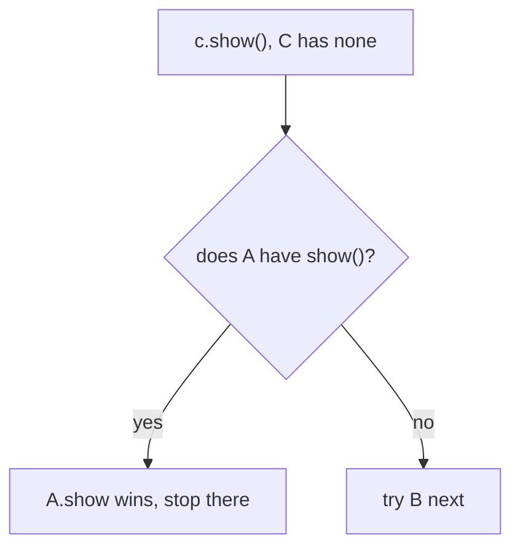
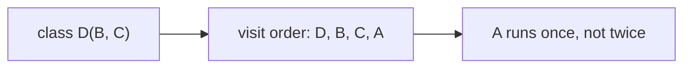

# 08 — MRO & Multiple Inheritance

> **MRO = the order in which Python searches classes to find a method or attribute — and `super()` walks exactly this order.**

Source: [Chat](../Python_OOP_Private_Variables_Chat.md) · Follows: [MASTER_TEACHING_STYLE.md](../../AGENT_STYLE/MASTER_TEACHING_STYLE.md) (Rule Sets 1 + 2)

---

## 0. Big Picture

| Question | Answer |
|---|---|
| **What is it?** | Method Resolution Order — the deterministic search path over a class's hierarchy. |
| **Why does it exist?** | With multiple parents, "which method wins?" must have ONE consistent answer. |
| **What problem does it solve?** | Ambiguity/diamond conflicts in multiple inheritance; makes `super()` cooperative. |
| **Where is it used?** | Mixins, ABCs, every `super()` call, framework class hierarchies. |
| **Prerequisites** | Notes 06–07. |
| **Bigger picture** | The engine behind inheritance lookup, overriding, and cooperative `super()` chains. |

---

## 1. WHAT — MRO in one line

**MRO = Method Resolution Order**

> **"Where will Python look first, second, third...?"**

```python
class A:
    def show(self): print("A")

class B(A): pass
class C(B): pass

c = C()
c.show()
```

```text
MRO: C → B → A → object
search: C ❌ → B ❌ → A ✅
output: A
```

Inspect it:

```python
print(C.mro())
# [C, B, A, object]
```

---

## 2. Types of inheritance

```text
Single:        Parent → Child

Multilevel:    Grandparent → Parent → Child

Hierarchical:         Parent
                      /    \
                     ↓      ↓
                  Child1  Child2

Multiple:      Parent1 ──┐
               Parent2 ──┼──→ Child
               Parent3 ──┘
```

Python supports all of them.

---

## 3. HOW — multiple inheritance: who wins?

```python
class A:
    def show(self): print("A")

class B:
    def show(self): print("B")

class C(A, B):
    pass

c = C()
c.show()
```

```text
MRO: C → A → B → object
C ❌ → A ✅ → STOP
output: A
```

**📊 Diagram — two parents? The left one is checked first**



**Bust the shortcut:** "the parent written earlier wins" is only a coincidence of simple cases. The real rule:

> **Python follows the MRO and uses the first class in the MRO that contains the required method.**

---

## 4. INTERNALS — `super()` in multiple inheritance (the surprise)

```python
class A:
    def show(self): print("A")

class B:
    def show(self): print("B")

class C(A, B):
    def show(self):
        print("C")
        super().show()

c = C()
c.show()
```

```text
C
A
```

`super()` inside `C` went to **A**, not to "the other parent B" — because the MRO says the next class after `C` is `A`.

And inside `A`, `super()` continues to **B** (next in MRO after A). That's the powerful chain behavior.

### Three levels of MRO itself

```text
Level 1 (Simple):    Python checks child, then parents left-to-right.
Level 2 (Precise):   The MRO is a total ordering of all classes; lookup takes
                     the first class containing the attribute.
Level 3 (Advanced):  Modern Python computes the MRO with C3 linearization,
                     which preserves local precedence order and keeps every
                     class before its parents — enabling sane diamonds.
```

**📊 Diagram — the diamond has one fixed visiting order**



---

## 5. Mental model

```text
                 INHERITANCE
                      │
                      ▼
             Child gets access
             to parent behavior
                      │
                      ▼
             METHOD LOOKUP (MRO)
                      │
            Search Child first
                      │
                not found?
                      ↓
                Search Parent(s)
                      │
                not found?
                      ↓
              Continue MRO → object
```

---

## 🎤 Interview Questions

1. **What is the MRO?** — The linear search order over a class hierarchy; first class defining the attribute wins.
2. **How do you view it?** — `Class.mro()` or `Class.__mro__`.
3. **What algorithm builds it?** — C3 linearization (children before parents, base-order preserved).
4. **In `class C(A, B)` where both define `show`, which runs?** — `A.show` — first in the MRO after `C`.
5. **What does `super()` do in multiple inheritance?** — Moves to the NEXT class in the instance's MRO, not necessarily "the other listed parent."
6. **What is the diamond problem and how does Python handle it?** — D→B,A→C diamond; C3 ensures common base (`C`) runs once, at the right position.

---

## ⭐ Key Takeaway

> **The first class in the MRO that has the method wins; `super()` just moves to the next class in that same order.**

---

## Cheat Sheet

```text
MRO
─────────────────────────────────────
print(Class.mro())          # see the order
lookup = walk MRO, first match wins

C(A, B)   →   MRO: C → A → B → object
super() in C → A ; super() in A → B   (order, not "parents")
built by C3 linearization; diamond-safe

TYPES: single | multilevel | hierarchical | multiple
```

---

## ✅ Progress

```text
WHAT YOU NOW KNOW:      MRO meaning, all 4 inheritance types,
                        why super() skips sideways in multiple inheritance
WHAT YOU SHOULD REMEMBER: first-in-MRO wins; super() = next step in MRO
WHAT WE LEARN NEXT:     note 09 — abstraction & abstract base classes
```
