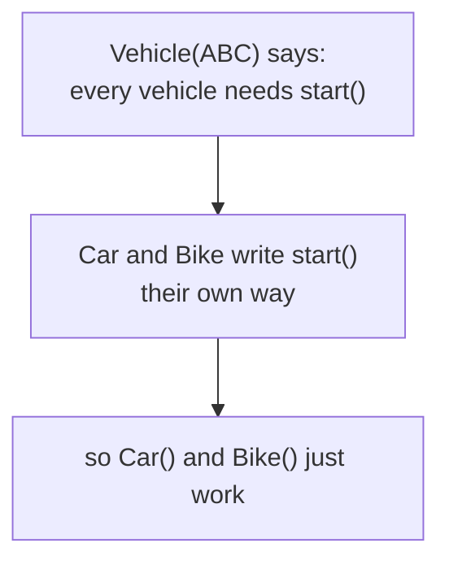
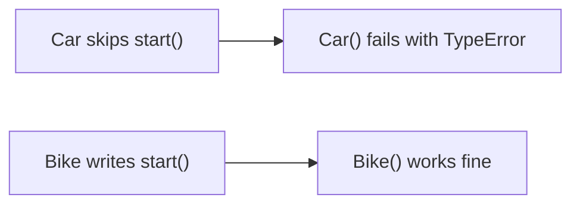

# 09 — Abstraction & ABC

> **Abstraction = define a common interface/contract while hiding specific implementation details — the parent says WHAT must exist, children decide HOW it works.**

Source: [Chat](../Python_OOP_Private_Variables_Chat.md) · Follows: [MASTER_TEACHING_STYLE.md](../../AGENT_STYLE/MASTER_TEACHING_STYLE.md) (Rule Sets 1 + 2)

---

## 0. Big Picture

| Question | Answer |
|---|---|
| **What is it?** | Exposing only the essential interface; forcing children to implement required methods. |
| **Why does it exist?** | To guarantee consistency across a family of classes ("every payment MUST have `pay()`"). |
| **What problem does it solve?** | Missing/inconsistent methods discovered at runtime → crashes; ABCs catch them at instantiation. |
| **Where is it used?** | Payment systems, plugins, storage backends, ML model interfaces, framework hooks. |
| **Prerequisites** | Notes 06–08 (inheritance, MRO). |
| **Bigger picture** | Pillar #2 of OOP; combines with overriding + polymorphism (see §6). |

---

## 1. WHAT — the idea from zero

ATM: you see `Check balance / Withdraw / Change PIN` — you never see server checks, database storage, authentication internals.

```text
You
 ↓
print()  /  withdraw()
 ↓
complicated implementation (hidden)
```

> **Abstraction = implementation hiding. Encapsulation = data protection.**

```text
Encapsulation → HOW to protect/hide data
Abstraction   → WHAT to show and what to hide
```

---

## 2. HOW — abstract classes in Python

```python
from abc import ABC, abstractmethod

class Vehicle(ABC):

    @abstractmethod
    def start(self):
        pass


class Car(Vehicle):
    def start(self):
        print("Car starts with key")

class Bike(Vehicle):
    def start(self):
        print("Bike starts with self-start")


car = Car();  car.start()
bike = Bike(); bike.start()
```

```text
Car starts with key
Bike starts with self-start
```

- **`ABC`** → makes the class an abstract base class
- **`@abstractmethod`** → every child MUST implement this method
- **Child** → provides the actual implementation

**📊 Diagram — Vehicle demands start(), kids deliver it**



---

## 3. Predict → break → reveal

```python
v = Vehicle()     # ❌ TypeError — abstract method not implemented
```

And if a child skips one:

```python
class Car(Vehicle):
    pass

c = Car()         # ❌ still abstract → error
```

**📊 Diagram — forget start() and Car() refuses to build**



Only when ALL abstract methods are implemented does the child become **concrete**:

```text
abstract method → WHAT (signature only)
concrete method → HOW  (signature + body)
abstract class  → cannot instantiate
concrete class  → can instantiate
```

---

## 4. Multiple abstract methods? Yes.

```python
class Vehicle(ABC):
    @abstractmethod
    def start(self): pass

    @abstractmethod
    def stop(self): pass

    @abstractmethod
    def fuel_type(self): pass
```

A child must implement **all of them** to become concrete. Implement only two → instantiation fails for the missing third.

- Abstract class → any number of abstract methods
- Python ABC → any number of `@abstractmethod`s
- Java functional interface → exactly **ONE** abstract method (⚠ common mix-up; it may also have `default`/`static` methods)

---

## 5. WHY it matters: the contract

```python
class Payment(ABC):
    @abstractmethod
    def pay(self, amount): pass

class UPI(Payment):
    def pay(self, amount): print("Paid using UPI:", amount)

class CreditCard(Payment):
    def pay(self, amount): print("Paid using Credit Card:", amount)
```

The system now knows: *whatever payment object it receives MUST have `pay()`.*

```text
             Vehicle / Payment
                     │
             "every child MUST have X()"
              ┌──────┴──────┐
              ↓             ↓
            Car           Bike
              │             │
         HOW it starts HOW it starts
```

---

## 6. INTERNALS — abstraction + overriding + polymorphism together

`Car.start()` is an **override** of the abstract `Vehicle.start()`:

```text
ABSTRACTION:  Vehicle says "every vehicle must have start()"
OVERRIDING:   Car says "here is MY implementation"
POLYMORPHISM: same call, different behavior

def start_vehicle(vehicle):
    vehicle.start()

start_vehicle(Car())    # Car starting
start_vehicle(Bike())   # Bike starting
```

The function only knows: *"this thing has a `start()` operation."*

### Three levels

```text
Level 1 (Simple):    Abstract class = template children must fill in.
Level 2 (Precise):   ABC + @abstractmethod blocks instantiation until every
                     abstract method has a concrete override in the MRO.
Level 3 (Advanced):  Instantiation check happens in object.__new__/__init__
                     via ABCMeta: if any abstractmethod remains unimplemented
                     in the class's MRO, TypeError is raised.
```

---

## 7. Comparison — Java ↔ Python bridge

```text
Java                         Python

abstract class       →       ABC
abstract method      →       @abstractmethod
extends              →       inheritance
@Override            →       method overriding
functional interface →       exactly ONE abstract method (no direct equivalent need)
```

Both: cannot instantiate the abstract type; concrete children can be instantiated.
Different: Java enforces at compile time; Python at instantiation time.

Also recall abstraction vs encapsulation table (note 02 §5).

---

## 🎤 Interview Questions

1. **What is an abstract class in Python?** — A class inheriting `ABC` with one or more `@abstractmethod`s; it cannot be instantiated directly.
2. **When exactly does Python reject an incomplete child?** — At instantiation (`Child()`), not at class definition.
3. **Abstract class vs interface?** — Abstract class may mix concrete + abstract members; an interface (Java) declares contract only; a *functional* interface has exactly one abstract method.
4. **Can an abstract class have a constructor?** — Yes — it runs when a concrete child calls `super().__init__()`; the abstract type itself still can't be instantiated.
5. **How do abstraction and polymorphism connect?** — The ABC guarantees the interface exists; polymorphism lets one call site work for every implementation.

---

## ⭐ Key Takeaway

> **An abstract class is a contract: it guarantees WHAT every child provides (`@abstractmethod`) while each child decides HOW — and you can only instantiate classes that fulfill the whole contract.**

---

## Cheat Sheet

```text
ABSTRACTION
─────────────────────────────────────
from abc import ABC, abstractmethod

class Base(ABC):
    @abstractmethod
    def must_have(self): pass     # WHAT

class Child(Base):
    def must_have(self): ...      # HOW (override)

Base()      ❌ abstract
Child()     ✅ only if ALL abstract methods implemented
check time: instantiation (ABCMeta), not definition

vs ENCAPSULATION: abstraction hides IMPLEMENTATION,
                  encapsulation protects DATA
```

---

## ✅ Progress

```text
WHAT YOU NOW KNOW:      ABC/@abstractmethod, instantiation-time enforcement,
                        Java mapping, all four OOP pillars connected
WHAT YOU SHOULD REMEMBER: ABC = contract; incomplete child fails at Child()
WHAT WE LEARN NEXT:     note 10 — classic Python gotchas (mutability & defaults)
```
