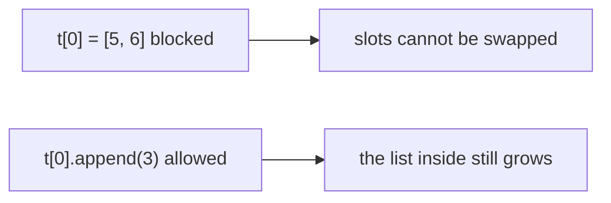
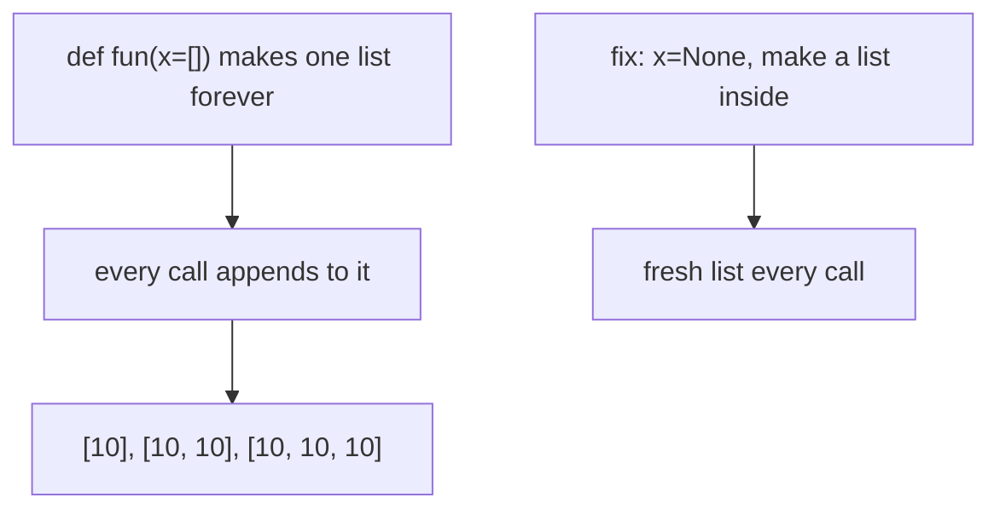

# 10 — Python Gotchas: Mutability & Default Arguments

> **Immutable containers lock their references, not the objects they point to — and mutable default arguments are created ONCE, then shared between calls.**

Source: [Chat](../Python_OOP_Private_Variables_Chat.md) · Follows: [MASTER_TEACHING_STYLE.md](../../AGENT_STYLE/MASTER_TEACHING_STYLE.md) (Rule Sets 1 + 2)

---

## 0. Big Picture

| Question | Answer |
|---|---|
| **What is it?** | Two classic traps: mutating "frozen" containers, and shared mutable defaults. |
| **Why do they exist (as traps)?** | Python evaluates defaults once at `def` time; immutability freezes slots, not targets. |
| **What problem does knowing this solve?** | Prevents state leaking between function calls and confusing "immutable but changed" moments. |
| **Where does it bite?** | Utility functions, accumulators, config defaults, OOP class attributes (note 04). |
| **Prerequisites** | Note 02 (references), note 04 (class attributes). |
| **Bigger picture** | Core of the mutable/immutable distinction that runs through ALL of Python. |

---

## 1. WHAT + HOW — immutable container, mutable content

```python
t = (1, 2, 3)
t[0] = 10          # ❌ TypeError — tuple immutable
```

But a tuple can **contain** a mutable object:

```python
t = ([1, 2], 3)

t[0] = [5, 6]      # ❌ cannot replace the element/reference
t[0].append(3)     # ✅ CAN modify the list itself
```

```text
t ──► ( ref ──► [1, 2, 3] ,  3 )
        ↑
   slot locked, but the list it points to is still mutable
```

**📊 Diagram — the tuple is locked, the list inside is not**



> **Immutable container → its elements/references cannot be replaced. But if an element itself is mutable, that object can still be modified.**

---

## 2. Predict → break → reveal — mutable default arguments

**Predict:** a fresh list every call.
**Break:**

```python
def fun(x=[]):
    x.append(10)
    print(x)

fun()   # [10]
fun()   # [10, 10]   ← SAME list reused!
fun()   # [10, 10, 10]
```

**📊 Diagram — one hidden list shared by every call**



The default `[]` is created **once** and shared across calls.

**Reveal — the fix:**

```python
def fun(x=None):
    if x is None:
        x = []
    x.append(10)
    print(x)

fun()   # [10]
fun()   # [10]
```

---

## 3. INTERNALS — prove the default is created once

### Three levels

```text
Level 1 (Simple):    The default list is made one time and reused.
Level 2 (Precise):   Default values are evaluated ONCE at function definition
                     and stored on the function object in __defaults__.
Level 3 (Advanced):  The def statement builds the function object at runtime;
                     each call binds parameters to those stored objects unless
                     arguments are passed — so mutations persist across calls.
```

**Proof:**

```python
def fun(x=[]):
    return x

print(fun.__defaults__)      # ([],)
fun().append(99)
print(fun.__defaults__)      # ([99],)  ← the default itself mutated!
```

---

## 4. Comparison — mutable vs immutable

| | Mutable | Immutable |
|---|---|---|
| Examples | list, dict, set | int, str, tuple, frozenset |
| In-place change | ✅ `lst.append(1)` | ❌ any "change" makes a new object |
| As dict key | ❌ (unhashable) | ✅ |
| As default arg | ⚠ dangerous (shared) | safe |
| Contained in tuple | contents can still change | fully frozen |

---

## 🎤 Interview Questions

1. **Why are mutable default arguments dangerous?** — Evaluated once at definition, stored in `__defaults__`, shared across all calls → state leaks.
2. **How to fix them?** — Sentinel `None` + create inside; or use `dataclasses.field(default_factory=list)` for dataclasses.
3. **Can a tuple change?** — Its slots can't be reassigned, but a mutable object it references can mutate through that reference.
4. **`(1, 2, [3, 4])` as a dict key?** — Fails: tuples are hashable only if their contents are hashable; the list isn't.
5. **Where else does this trap appear in OOP?** — Class attributes like `items = []` shared by every instance (note 04).

---

## ⭐ Key Takeaway

> **Never use a mutable object (`[]`, `{}`, `set()`) as a default argument unless you deliberately want shared state — use `None` and create the object inside the function.**

---

## Cheat Sheet

```text
MUTABILITY
─────────────────────────────────────
tuple "freezes" its SLOTS (references),
not the objects those slots point to.

DEFAULT ARGS
def f(x=[])       ❌ one shared list forever (lives in f.__defaults__)
def f(x=None):    ✅ fresh object per call
    if x is None:
        x = []

RULE: immutable → safe to share; mutable + shared → bug factory
```

---

## ✅ Progress

```text
WHAT YOU NOW KNOW:      why tuples aren't fully frozen, why defaults leak,
                        and the __defaults__ proof
WHAT YOU SHOULD REMEMBER: defaults evaluated once at def time
WHAT WE LEARN NEXT:     next topic of your choice — decorators, generators,
                        or start NumPy per Rule Set 2 roadmaps
```
