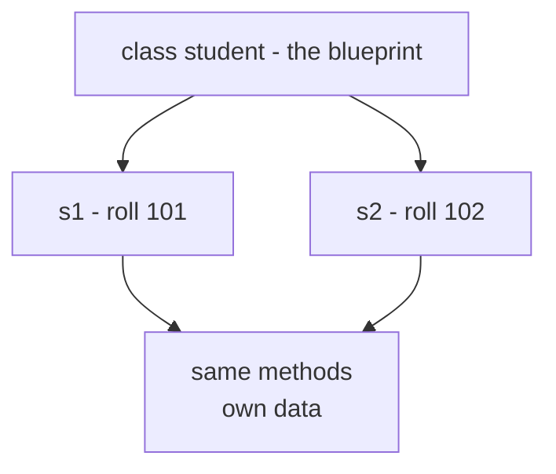
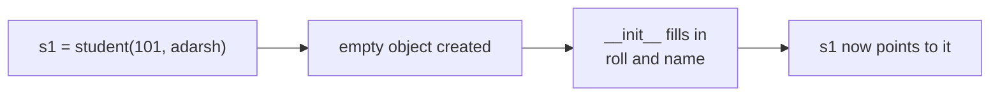
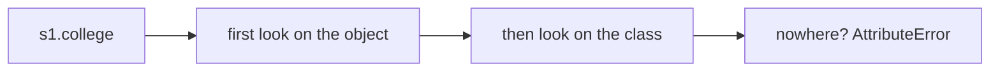

# Classes & Objects

> **A class is a blueprint. An object is a real thing built from that blueprint. Data and functions live together inside it.**

Follows: [MASTER_TEACHING_STYLE.md](../../AGENT_STYLE/MASTER_TEACHING_STYLE.md) (Rule Sets 1 + 2 + 3)

## Status
- Status: New / Learning
- Prerequisites: Functions, dicts, `self` awareness, scope (LEGB), mutability
- Last studied: Day 4
- Confidence: Building

---

## 🗺️ 0. Big Picture

| Question | Simple answer |
|---|---|
| **What is it?** | A class = design. An object = one real thing made from that design. |
| **Why does it exist?** | So data and the functions that manage it live together in ONE place. |
| **What problem does it solve?** | Loose variables scattered everywhere that nobody owns or protects. |
| **Where will you see it?** | Every sklearn model, every PyTorch network — they are ALL classes. |
| **What do you need first?** | Functions, dicts, references/mutability (Day 2). |
| **Bigger picture** | This is OOP pillar #1 — everything else stands on it. |

---

## 1. 🎯 Why should you care?

### The house analogy 🏠

```text
Blueprint     ──────────►  House     ──────────►  House
(class)                    (object 1)             (object 2)

One blueprint. Many houses.
Same structure, different paint/furniture (data).
```

You don't rebuild the plan for every house.
You build the plan ONCE, then stamp out houses from it.

### You already use classes every day!

```python
from sklearn.linear_model import LinearRegression

model = LinearRegression()     # ← CLASS turned into an OBJECT
model.fit(X_train, y_train)    # ← method call (a function inside the object)
pred = model.predict(X_test)   # ← another method
```

Walk through it:

```text
LinearRegression()       builds a fresh model object
model.fit(...)           the object LEARNS (stores coefficients inside itself)
model.predict(...)       the object USES what it learned
```

The object carries:

- **data** → the coefficients, the fitted flag
- **behavior** → `fit`, `predict`

That's the whole idea: **bundle data + behavior into one thing.**

Once you see this, sklearn and PyTorch stop being magic. They are just classes.

---

## 2. 🧠 The mental model

```text
        class student      (the blueprint)
              │
              │  student(101)     student(102)
              ▼                       ▼
      ┌──────────────┐        ┌──────────────┐
      │ s1           │        │ s2           │
      │ roll: 101    │        │ roll: 102    │
      └──────────────┘        └──────────────┘
       own data ✅             own data ✅
       same methods            same methods
```

**📊 Diagram — one class, many objects**



- One blueprint → many objects
- Each object has its OWN data
- All objects SHARE the same methods

Exactly like two `LinearRegression()` models trained on different data.

---

## 3. 🏭 Your first class — step by step

This code makes a blueprint and builds one object from it:

```python
class student:                      # ① the blueprint
    def __init__(self, roll, name):
        self.roll = roll            # ③ store roll ON this object
        self.name = name            # ③ store name ON this object

    def display(self):              # behavior — a function inside the class
        print(self.name, self.roll)

s1 = student(101, "adarsh")         # ② build an object
s1.display()                        # adarsh 101
```

### What each piece means 🧩

| Piece | Plain meaning |
|---|---|
| `class student:` | "I'm making a blueprint named student" |
| `__init__` | The **setup function** — runs AUTOMATICALLY when an object is born |
| `self` | "THIS object" — the one being built or used right now |
| `self.roll = roll` | "Glue the value of roll onto THIS object" |
| `display` | A normal function that lives inside the class |
| `s1 = student(...)` | Build! Python calls `__init__` for you |

### Memory picture after `s1 = student(101, "adarsh")` 🔍

```text
s1
 │
 ▼
┌──────────────────────┐
│ student object       │
│ roll  ───────────────┼──► 101
│ name  ───────────────┼──► "adarsh"
└──────────────────────┘
```

`s1` is not the data. `s1` is a **name tag pointing at the object**.

---

## 4. 🔍 What Python does inside (internals)

When you write `s1 = student(101, "adarsh")`, Python secretly does 4 steps:

```text
① create an empty object          (__new__ does this)
        ↓
② call __init__(s1, 101, ...)     ← s1 gets passed as "self"!
        ↓
③ __init__ glues attributes on s1 (roll, name)
        ↓
④ point the name s1 at the finished object
```

**📊 Diagram — what happens when you make an object**



### 💡 The big secret about `self`

`s1.display()` and `student.display(s1)` are THE SAME THING:

```text
s1.display()              Python turns it into     student.display(s1)
                                                      ↑
                                              object passed as first arg
```

`self` is NOT magic. It's just the object, passed in automatically. That's why every instance method starts with `self`.

---

## 5. 🆚 Class attributes vs instance attributes

Two places data can live:

```text
class student:                ←    class attribute: ONE copy, shared by all
    college = "GL bajaj"

    def __init__(self, roll): ←    instance attribute: one copy PER object
        self.roll = roll
```

### How Python finds an attribute (lookup order) 🔍

```text
s1.college
   ↓
   look on the OBJECT s1        → found? use it ✅
   ↓ not there
   look on the CLASS student    → found? use it ✅
   ↓ not there
   AttributeError ❌
```

**📊 Diagram — where Python finds an attribute**



### See it work

```python
s1 = student(101)
s2 = student(102)

print(s1.roll)      # 101        ← found on the OBJECT (step   )
print(s1.college)   # GL bajaj   ← not on object → found on CLASS (step   )
```

### Side-by-side comparison 🆚

| | Class attribute | Instance attribute |
|---|---|---|
| Lives in | the class | each object |
| Copies | ONE, shared | many, one per object |
| Created by | assignment in class body | `self.x =...` in `__init__` |
| Checked | SECOND (fallback) | FIRST |

### ⚠️ TRAP: mutable class attributes are SHARED

```python
class student:
    marks = []          # ❌ BAD IDEA — one list for EVERYONE

s1 = student()
s2 = student()
s1.marks.append(90)
print(s2.marks)         # [90]    — s2 sees it too!
```

Why? Both names point to the SAME list:

```text
s1.marks ──┐
           ├──► [90]  (one single list in memory)
s2.marks ──┘
```

✅ Fix: put mutable data on the INSTANCE inside `__init__`.

---

## 6. ⚠️ Common mistakes

### Mistake 1 — forgetting `self` ❌

```python
class student:
    def display():        # ❌ no self!
        print("hi")

s1.display()              # TypeError — Python passed s1 in, but no slot to receive it
```

Python ALWAYS passes the object in. The method must have a slot (`self`) ready to catch it.

### Mistake 2 — spelling `__init__` wrong ❌

```python
def __int__(self, roll):   # ❌ typo — NEVER runs, NO error shown
```

Silent bug. Object gets built with no attributes. If your constructor "doesn't run" — check spelling first.

### Mistake 3 — thinking `self` is a keyword ❌

`self` is just a name (convention). You could write `this` or `me`. But **never fight the convention** — everyone uses `self`.

### Mistake 4 — mutable class attribute ❌

(The shared-list trap above)

### Mistake 5 — using the class like an object ❌

```python
student.roll    # ❌ AttributeError — roll lives on INSTANCES, not the class
```

```text
   class  → has college (shared stuff)
   object → has roll, name (per-object stuff)
Don't mix them up!
```

---

## 7. 🤖 ML connection

```text
sklearn                             PyTorch
──────────────────                  ─────────────────
LinearRegression()  = class         nn.Module       = class
model               = object        your Net        = subclass
model.coef_         = data          self.layers     = data
model.fit()         = method        forward()       = method
```

- Custom PyTorch datasets are classes with `__len__` and `__getitem__`
- Config/data classes (`@dataclass`) are still classes — less typing, same idea
- Reading ML code = reading classes. Get this, and libraries feel normal.

---

## 8. 🎯 PREDICT drills

Say your answer OUT LOUD before reading ours.

### Drill 1

```python
class box:
    def __init__(self, w, h):
        self.w = w
        self.h = h
    def area(self):
        return self.w * self.h

b = box(3, 4)
print(b.area())
```

**Answer:** `12` ✅ — `area` reads `self.w` (3) and `self.h` (4) from the object.

### Drill 2

```python
class counter:
    count = 0                      # class attribute
    def __init__(self):
        counter.count += 1         # bump the SHARED counter

a = counter()
b = counter()
c = counter()
print(counter.count)
```

**Answer:** `3` ✅ — every object birth bumps the ONE shared counter.

### Drill 3 — trap ⚠️

```python
class student:
    def __init__(self, roll):
        self.roll = roll

s1 = student(101)
s1.roll = 999          # allowed?? what happens?
print(s1.roll)
```

**Answer:** `999` ✅ — Python lets you change/add attributes ANY TIME. No protection by default. (That's why encapsulation exists — topic 03!)

### Drill 4 — trickier

```python
class student:
    name = "anonymous"     # class attribute

s = student()
print(s.name)              # ???
s.name = "adarsh"          # ???
print(s.name)              # ???
print(student.name)        # ???
```

**Answer:** `anonymous` → `adarsh` → `anonymous` ✅

```text
s.name = "adarsh" creates a NEW attribute ON THE OBJECT
It SHADOWS (covers) the class one — but the class copy is untouched
```

### Drill 5 — order matters

```python
s = student(101)
student.display(s)     # calling through the CLASS — works?
```

**Answer:** `101` ✅ — identical to `s.display()`. Proof that `self` is just the object passed as first argument.

---

## 9. 🧪 Experiment

1. Open your `oops.py`. Add a second object `s2`. Change `s2`'s marks — check `s1` is unaffected, but `college` stays shared.
2. Print `s1.__dict__` — see the object's real storage (a dict!).
3. Make a class with `marks = []` (class attribute). Mutate via one object. Watch both change.
4. Check `type(s1)` and `s1.__class__` — both point back to the class.

---

## 10. 🎤 Interview questions

**Q: What is `self` in Python?**
Simple: the current object, passed automatically as the first argument.
Stronger: `self` is a convention, not a keyword. `obj.method(x)` really calls `Class.method(obj, x)` — the object rides in as arg #1.

**Q: `__init__` vs `__new__`?**
Simple: `__new__` BUILDS the empty object; `__init__` FILLS it.
Stronger: `__new__` creates and returns the instance (rarely overridden); `__init__` then initializes it. Normal code only touches `__init__`.

**Q: Class vs instance attribute — which wins?**
Instance wins. Lookup checks the object's `__dict__` first, then the class. Assigning via the instance only creates/changes the instance copy.

**Q: Why are mutable class attributes dangerous?**
All instances share the SAME list/dict object (reference sharing, Day 2). One mutates → everyone sees it. Store mutable state per-instance in `__init__`.

---

## 11. 📄 Cheat sheet

```text
CLASSES & OBJECTS
═══════════════════════════════════════
   class    = blueprint (one)
   object   = thing built from it (many)

MAKE ONE
→ class Name:
      def __init__(self, x): self.x = x
      def method(self): ...
→ obj = Name(5)

GOLDEN RULES
→ obj.method() ≡ Name.method(obj)   (self = the object)
→ lookup: object    first → class    second
→ mutable class attr = shared by ALL objects ⚠

ML CONNECTION
→ every estimator / module / dataset = a class
```

---

## ⭐ Key Takeaway

> **A class is the blueprint, objects are the built things, `self` is the object passed automatically — and lookup always checks the object FIRST, then the class.**

---

## ✅ Progress

```text
WHAT YOU NOW KNOW:        class vs object, __init__, self, class vs
                          instance attributes, how obj.method() really works
WHAT YOU SHOULD REMEMBER: self = the object (auto-passed);
                          lookup = object first, class second;
                          mutable class attrs are shared traps ⚠
WHAT WE LEARN NEXT:       topic 02 — the 3 method flavors & @property
```

Next: [Instance / Class / Static Methods](./02-instance-class-static-methods.md)
