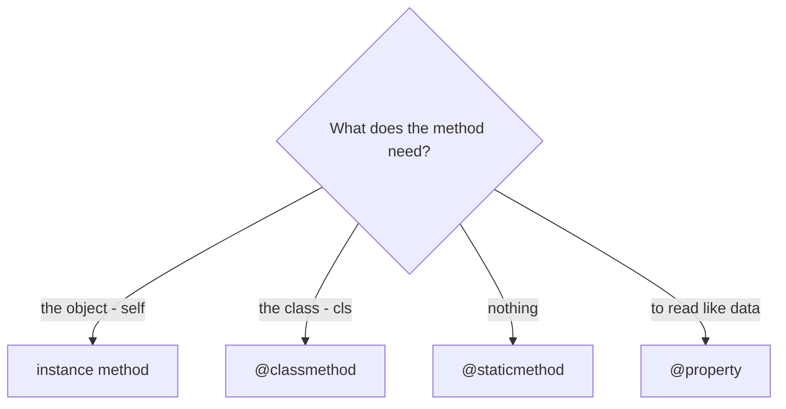
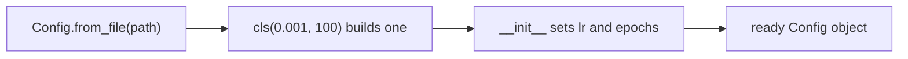
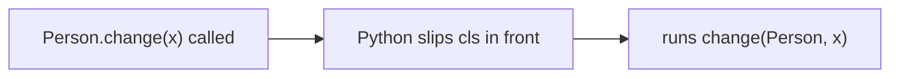
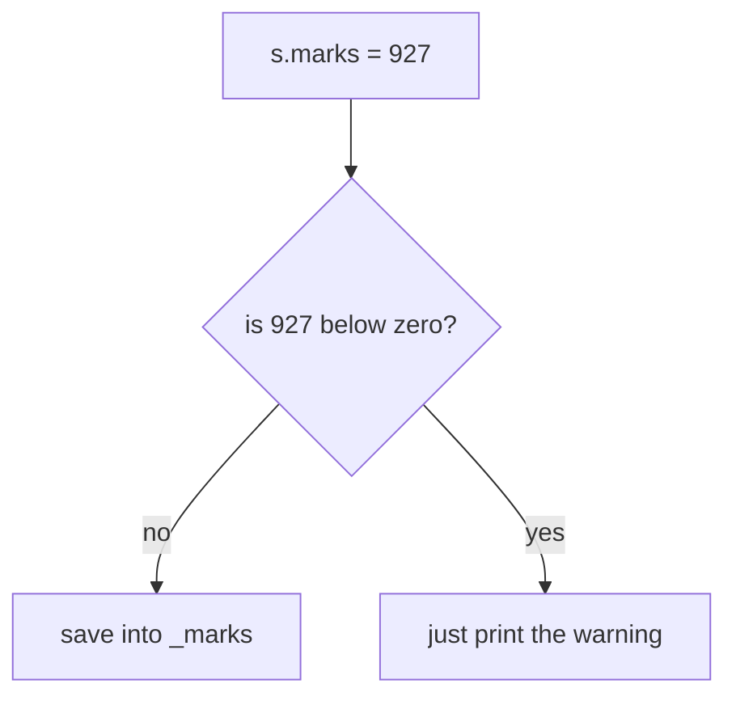

# Instance / Class / Static Methods

> **Methods come in 3 flavors — instance (gets the object), class (gets the class), static (gets nothing) — plus `@property`, which runs code but looks like plain data.**

Follows: [MASTER_TEACHING_STYLE.md](../../AGENT_STYLE/MASTER_TEACHING_STYLE.md) (Rule Sets 1 + 2 + 3)

## Status
- Status: New / Learning
- Prerequisites: [Classes & Objects](./01-classes-objects.md), scope (LEGB), decorators basics
- Last studied: Day 4
- Confidence: Building

---

## 🗺️ 0. Big Picture

| Question | Simple answer |
|---|---|
| **What is it?** | 3 kinds of methods + 1 attribute-disguise trick (`@property`). |
| **Why does it exist?** | Different jobs need different state — one object's data, shared class data, or none. |
| **What problem does it solve?** | Wrong-state bugs; gives clean alternative constructors and computed attributes. |
| **Where will you see it?** | pandas `from_dict` constructors, sklearn validators, lazy metrics everywhere. |
| **What do you need first?** | Topic 01, decorators basics. |
| **Bigger picture** | All 4 are "descriptors" — same machinery PyTorch uses for parameters. |

---

## 1. 🎯 Why should you care?

So far every method you wrote was an **instance method** — it needs `self`, it works on ONE object.

But Python gives methods **three flavors**, and each answers a different question:

```text
   "Work on ONE object's data?"          → instance method  (self)
   "Work on the CLASS / shared data?"    → class method     (cls)
   "Just a helper, needs nothing?"       → static method    (nothing)
   "Compute a value but read like data?" → @property        (magic   )
```

**📊 Diagram — which method flavor do you need?**



ML code uses ALL of them:

- pandas → `@classmethod` for alternative constructors
- sklearn → `@staticmethod` for validation helpers
- `@property` → everywhere a value should be computed lazily

---

## 2. 🧠 The mental model

The decorator decides what gets passed in:

```text
you call:              Python secretly passes:
─────────────────────────────────────────────
obj.inst(...)      →   the OBJECT  (self)
Class.clsm(...)    →   the CLASS    (cls)
Class.stat(...)    →   NOTHING extra
obj.prop           →   runs code, looks like data
```

```python
class example:
    def inst(self):      print("got", self)      # the object
    @classmethod
    def clsm(cls):       print("got", cls)       # the class
    @staticmethod
    def stat():          print("got nothing")    # plain function
    @property
    def prop(self):      return 42               # computed attribute
```

### Side-by-side comparison 🆚

| | receives | typical use | called as |
|---|---|---|---|
| instance method | `self` | per-object behavior | `obj.f()` |
| class method | `cls` | shared state, alt constructors | `Class.f()` |
| static method | nothing | related utility | `Class.f()` |
| property | `self` on read/write | computed/validated attribute | `obj.attr` ← no parens! |

---

## 3. 📖 Each flavor — step by step

### 3.1 Instance method (you know this one ✅)

```python
class student:
    def __init__(self, roll):
        self.roll = roll
    def show(self):               # needs the object
        print(self.roll)
```

### 3.2 Class method — `@classmethod` 🏭

Gets the CLASS itself as `cls`. Two big uses:

**Use A — change shared class state.** Your `inh.py` did exactly this:

```python
class Person:
    name = "anonymous"            # class attribute

    @classmethod
    def change(cls, name):
        cls.name = name           # changes the CLASS's name

p1 = Person()
p1.change("Saumitra")
print(p1.name)              # Saumitra
print(Person.name)          # Saumitra  ← changed through the class!
```

Walk through it:

```text
p1.change("Saumitra")
      ↓
cls = Person (the CLASS, not p1!)
      ↓
Person.name = "Saumitra"      updated for everyone
```

⚠ Note: calling it via `p1` still changed the CLASS attribute — not `p1`'s own.

**Use B — alternative constructors.** The most common real-world use:

```python
class Config:
    def __init__(self, lr, epochs):
        self.lr = lr
        self.epochs = epochs

    @classmethod
    def from_file(cls, path):        # 2nd door into the same class
        lr, epochs = 0.001, 100      # (imagine parsing here)
        return cls(lr, epochs)       # ← cls() builds a Config!

c = Config.from_file("config.txt")
```

**📊 Diagram — a second door into the same class**



```text
One class   , many doors   :
Config(0.001, 100)         ← normal door
Config.from_file(path)     ← side door that parses first
```

`cls()` works even for SUBCLASSES — it builds whoever called.

### 3.3 Static method — `@staticmethod` 🚫

A plain function that just LIVES inside the class for organization:

```python
class math_utils:
    @staticmethod
    def clip(x, lo, hi):
        return max(lo, min(x, hi))

print(math_utils.clip(150, 0, 100))    # 100
```

No `self`, no `cls` — nothing passed automatically. It's grouping, nothing more.

### 3.4 Property — computed attributes ✨ (the real star!)

Read a COMPUTED value like plain data:

```python
class student:
    def __init__(self, p, c, m):
        self.p = p
        self.c = c
        self.m = m

    @property
    def percentage(self):              # looks like an attribute...
        return (self.p + self.c + self.m) / 3   # ...but runs code!

s = student(89, 88, 83)
print(s.percentage)        # 86.66...  ← NO parentheses!
```

And it's ALWAYS fresh — recompute on every read:

```text
s.p = 94
   ↓
s.percentage      recomputes with new marks     88.33
```

No stored copy to forget to update. That's the whole point of properties.

---

## 4. 🔍 What Python does inside (internals)

```python
@classmethod
def f(cls): ...
```

is EXACTLY the same as:

```python
f = classmethod(f)      # wrap the function in a classmethod object
```

That wrapper is a **descriptor**. When you access `Person.change`, the wrapper passes the CLASS instead of the instance:

```text
Person.change("x")
      ↓
classmethod descriptor wakes up
      ↓
calls change(Person, "x")     ← cls inserted automatically
```

**📊 Diagram — how @classmethod gets its cls**



Same story:

```text
@staticmethod  →  descriptor passes NOTHING
@property      →  descriptor calls fget(self) on every read
```

### Property read pattern 🔍

```text
s.percentage
     ↓
find property descriptor on the CLASS
     ↓
call getter: percentage(s)
     ↓
return the computed value
```

There is NO stored `percentage` inside `s.__dict__` — computed fresh on EVERY access.

### At three levels 🪜

```text
Level 1 (Simple):    instance = needs object; class = needs class;
                     static = needs nothing; property = method in disguise.
Level 2 (Precise):   @classmethod/@staticmethod are descriptors; access binds
                     cls or nothing; @property routes reads→fget, writes→fset.
Level 3 (Advanced):  all four implement the descriptor protocol — same
                     mechanism behind nn.Module parameter tracking; lookup
                     happens on the TYPE, not the instance.
```

---

## 5. ⚠️ The bug in your `inh.py` — and why it failed

Your last `inh.py` block had a classic double-trap:

```python
class student:
    def __init__(self):
        self.marks = 0

    @marks.setter                    # ❌ BUG 1
    def marks(self, val):
        if val < 0:
            print("marks cannot be negative")
        else:
            self.marks = val         # ❌ BUG 2

    @property
    def percentage(self):
        return self.marks / 10
```

### Bug 1 — setter before the property exists ❌

Decorators run top-to-bottom at class creation:

```text
line by line:
  __init__        ✅ defined
  @marks.setter   ❌ there is NO property named "marks" yet!
                  → NameError: name 'marks' is not defined
```

✅ Fix: the setter must come AFTER its property.

### Bug 2 — infinite recursion ♾️

Even with correct order:

```text
self.marks = val   (inside the setter)
      ↓
triggers the SETTER again!
      ↓
self.marks = val
      ↓
... forever     → RecursionError
```

✅ Fix: store into a HIDDEN backing attribute `_marks`.

### The correct pattern ✅

```python
class student:
    def __init__(self, marks=0):
        self._marks = marks            # the REAL storage

    @property
    def marks(self):                   # getter FIRST
        return self._marks

    @marks.setter
    def marks(self, val):              # setter AFTER the property
        if val < 0:
            print("marks cannot be negative")
        else:
            self._marks = val          # ← writes the BACKING attribute ✅

    @property
    def percentage(self):
        return self._marks / 10

s = student()
s.marks = 927
print(s.percentage)      # 92.7
s.marks = -5             # marks cannot be negative
```

### The flow of a safe write 🔍

```text
s.marks = 927
     ↓
setter fires → is 927 < 0? NO
     ↓
self._marks = 927   (plain attribute — no property, no loop ✅)
```

**📊 Diagram — saving marks through the safety check**



Golden rule: **public name (`marks`) = the property; real data lives in `_marks`. The setter NEVER assigns to its own public name.**

---

## 6. ⚠️ Common mistakes

| Mistake ❌ | Why it hurts |
|---|---|
| `@classmethod` method using `self` | `cls` is passed, not an object — `self` won't exist |
| Calling `percentage()` with parens | works, but callers expect attribute syntax (no parens!) |
| `@marks.setter` BEFORE the property | `NameError` at class definition |
| Setter assigning `self.marks = val` | infinite recursion |
| `@staticmethod` when you need class state | you'll hardcode the class name — breaks subclasses |
| Using `Class(...)` inside a classmethod | use `cls(...)` — works for subclasses too |

---

## 7. 🤖 ML connection

```text
pandas      → DataFrame.from_dict(...)     = classmethod constructor
sklearn     → validation helpers           = staticmethods
your model  → model.accuracy               = @property (computed)
configs     → Config.from_file(path)       = classmethod loader
PyTorch     → nn.Module parameters         = descriptors (same machinery!)
```

- Properties validate hyperparameters: a `learning_rate` setter that rejects negatives
- Static helpers check input shapes without needing an instance

---

## 8. 🎯 PREDICT drills

Say your answer OUT LOUD first!

### Drill 1

```python
class a:
    x = 1
    @classmethod
    def bump(cls):
        cls.x += 1

a.bump()
print(a.x)
```

**Answer:** `2` ✅ — `cls` IS `a`, so `a.x` got incremented.

### Drill 2

```python
class student:
    def __init__(self, marks):
        self._marks = marks
    @property
    def grade(self):
        if self._marks >= 90: return "A"
        if self._marks >= 75: return "B"
        return "C"

s = student(85)
print(s.grade)
```

**Answer:** `B` ✅ — property computes grade on demand.

### Drill 3 — trap ⚠️

```python
class point:
    def __init__(self, x):
        self._x = x
    @property
    def x(self):
        return self._x
    @x.setter
    def x(self, value):
        self._x = value

p = point(5)
p.x = 10
print(p._x, p.x)
```

**Answer:** `10 10` ✅ — setter stores into `_x`, getter reads it back.

### Drill 4 — trickier

```python
class a:
    val = 10
    @classmethod
    def get(cls):
        return cls.val

class b(a):
    val = 99

print(a.get())
print(b.get())
```

**Answer:** `10` then `99` ✅

```text
a.get() → cls = a → a.val = 10
b.get() → cls = b → b.val = 99   ← cls follows WHOEVER called!
```

This is why `cls` beats hardcoding the class name.

### Drill 5 — the recursion trap ♾️

```python
class student:
    def __init__(self):
        self.marks = 0        # goes through the SETTER!
    @property
    def marks(self):
        return self._marks
    @marks.setter
    def marks(self, val):
        self._marks = val     # writes to _marks — safe ✅

s = student()
s.marks = 50
print(s.marks)
```

**PREDICT:** crash or work?

**Answer:** works, prints `50` ✅ — `__init__`'s write went through the setter (fine), and the setter writes to `_marks` (not the public name), so NO loop. The trap only bites when the setter assigns to its own public name.

---

## 9. 🧪 Experiment

1. Fix your `inh.py` block using the `_marks` backing pattern. Run it. ✅
2. Add `@property percentage` to your `oops.py` student; delete the stored average; verify it stays correct when marks change.
3. Write `Config.from_file` as a classmethod; subclass it; confirm `from_file` builds the SUBCLASS.
4. Print `Person.change` without calling it — see `<bound method...>` (the binding made visible!).

---

## 10. 🎤 Interview questions

**Q: Instance vs class vs static — when do you use each?**
Simple: object stuff → instance; class-level stuff or alt constructors → class; helper → static.
Stronger: the choice is about WHAT STATE the method needs — instance state, class state, or none.

**Q: What is a property and why use it?**
Simple: a computed value you read like data.
Stronger: `@property` exposes a method as an attribute — lazy computation, validation on assignment, and the internal representation can change without breaking callers.

**Q: The recursion trap in setters?**
Simple: assigning the public name inside its own setter loops forever.
Stronger: `self.marks = val` inside `@marks.setter` re-invokes the setter → `RecursionError`. Store into a private backing attribute (`_marks`).

**Q: Why is `cls(...)` better than `ClassName(...)` in a classmethod?**
`cls` is whoever CALLED — for a subclass it builds the subclass. Hardcoding breaks inheritance (Drill 4!).

---

## 11. 📄 Cheat sheet

```text
METHOD FLAVORS
═══════════════════════════════════════
what gets passed decides the type:
  object     → instance method   (self)
  class      → classmethod       (cls)
  nothing    → staticmethod      ()
  code-as-data    → @property    (no parens!)

SYNTAX
→ @classmethod  def f(cls): ...
→ @staticmethod def f(): ...
→ @property     def attr(self): return ...
→ @attr.setter  def attr(self, val): ...

GOLDEN RULES
→ setter comes AFTER its property
→ setter writes to _backing, NEVER to the public name
→ use cls(...) not ClassName(...)

TRAPS ⚠
→ @name.setter before property = NameError
→ self.name = val in own setter = RecursionError
```

---

## ⭐ Key Takeaway

> **What the decorator passes in decides the flavor — object → instance, class → classmethod, nothing → staticmethod; `@property` turns computation into attribute syntax.**

---

## ✅ Progress

```text
WHAT YOU NOW KNOW:        3 method flavors, @property get/set,
                          alternative constructors, the recursion trap
WHAT YOU SHOULD REMEMBER: what gets passed = the flavor; setter AFTER
                          property, writing to _backing only
WHAT WE LEARN NEXT:       topic 03 — encapsulation & name mangling
```

Next: [Encapsulation](./03-encapsulation.md)
