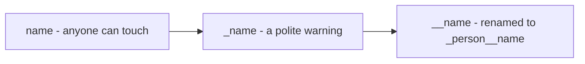
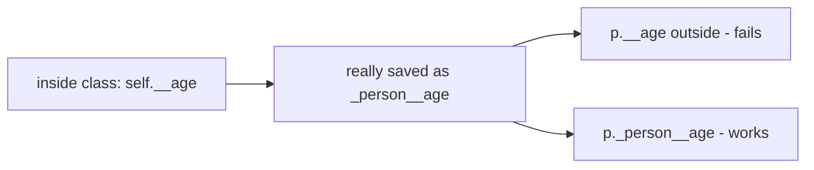
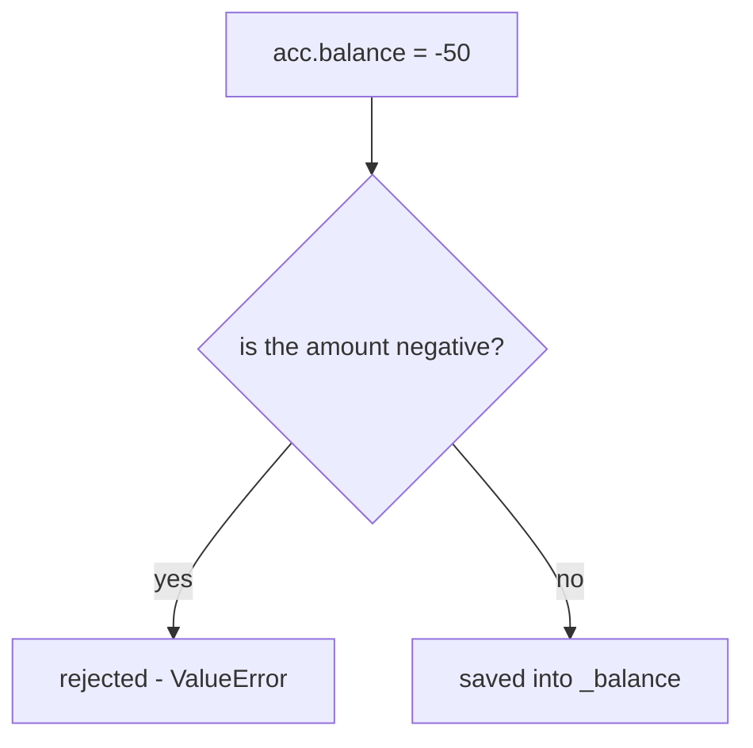
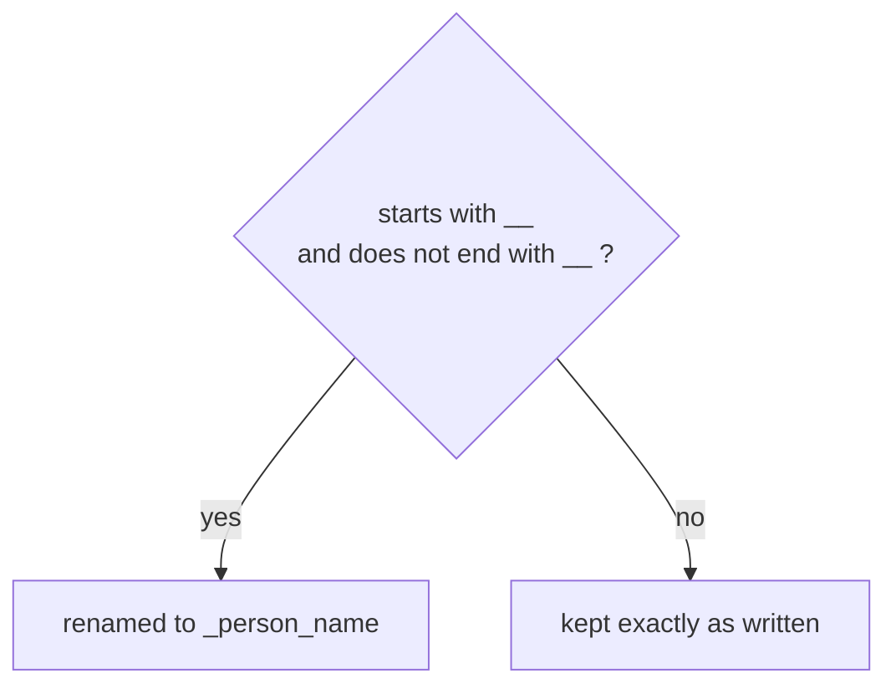

# Encapsulation

> **Encapsulation = hide the inside stuff and force every change through a guarded door ✅ — in Python this is done by convention (`_x`) and renaming (`__x`), NOT by keywords.**

Follows: [MASTER_TEACHING_STYLE.md](../../AGENT_STYLE/MASTER_TEACHING_STYLE.md) (Rule Sets 1 + 2 + 3)

## Status
- Status: New / Learning
- Prerequisites: [Classes & Objects](./01-classes-objects.md), [Methods](./02-instance-class-static-methods.md), mutability & references (Day 2)
- Last studied: Day 4
- Confidence: Building

---

## 🗺️ 0. Big Picture

| Question | Simple answer |
|---|---|
| **What is it?** | Hide internal state; expose a small, safe public surface. |
| **Why does it exist?** | Uncontrolled writes corrupt things — negative balances, broken models. |
| **What problem does it solve?** | "Any code anywhere can change anything" → now there's ONE guarded door. |
| **Where will you see it?** | sklearn's `coef_`, PyTorch weights, every validated config class. |
| **What do you need first?** | Topics 01–02 (attributes, properties). |
| **Bigger picture** | OOP pillar #2 — pairs with abstraction: protect the inside, publish the contract. |

---

## 1. 🎯 Why should you care?

### The ATM analogy 🏧

```text
❌ No encapsulation:
   anyone can reach into the vault    and grab/edit cash directly

✅ With encapsulation:
   everyone MUST go through the ATM
   the ATM checks your PIN, checks the amount, THEN acts
```

Your `OOPS2.PY` banking experiment was exactly this — the password/balance should not be casually readable or changeable from outside.

> **Encapsulation = hiding internal state + forcing access through controlled methods.**

Why care?

- A balance must never become negative
- A model's weights must not be randomly overwritten
- A dataset's labels must not be silently edited

If everything is public, **any code anywhere can corrupt your object** — and you'll never know where it came from.

---

## 2. 🧠 The mental model — Python's honesty rule

Python does NOT have `private` like Java. It has conventions:

```text
        everything is TECHNICALLY accessible
                      ↓
        but good design says:
        "these are public, these are internal"
                      ↓
   ┌──────────────────┼──────────────────┐
   ↓                  ↓                  ↓
 name              _name              __name
(fully open)    ("internal,         (gets RENAMED
                 please don't touch") to _Class__name)
```

**📊 Diagram — three levels of hiding names**



| Syntax | Meaning | Real protection? |
|---|---|---|
| `name` | fully public — read/write freely | no |
| `_name` | **convention**: "internal, don't touch" | no — just a warning to humans |
| `__name` | **name mangling** — renamed to `_ClassName__name` | partly (renaming, not security) |
| `__name__` | dunder hook (`__init__`, `__str__`) — Python's OWN machinery | n/a — not private at all! |

Don't confuse `__x` (mangled) with `__x__` (dunder protocol). Two underscores on BOTH sides = Python's system, not privacy.

---

## 3. 📖 Core concept — step by step

### 3.1 Single underscore `_name` — the polite request 🤫

```python
class Model:
    def __init__(self):
        self._weights = None      # "internal — please don't touch"
```

It's 100% accessible. The underscore is a sign saying "wet floor" — it doesn't lock the door, it just warns you.

### 3.2 Double underscore `__name` — the rename trick 🔒

```python
class person:
    def __init__(self, name, age):
        self.name = name
        self.__age = age          # becomes _person__age !!

p = person("rahul", 23)
print(p.name)        # rahul ✅
print(p.__age)       # ❌ AttributeError!
```

### But here's the surprise... 🤯

The attribute is NOT gone. It just got a new name:

```python
print(p.__dict__)           # {'name': 'rahul', '_person__age': 23}
print(p._person__age)       # 23  ← right there!
```

### What actually happened 🔍

```text
you wrote:      self.__age
                     ↓
Python rewrote: self._person__age     (at CLASS DEFINITION time)
                     ↓
outside the class, p.__age finds nothing → AttributeError ❌
but p._person__age works fine          → 23 ✅
```

**📊 Diagram — where __age secretly went**



**It's a rename, not a lock.** Your own `OOPS2.PY` even called a mangled method:

```python
p._person__hello()     # legal! "hi nice to meet you rahul"
```

Works fine — it's just ugly, and a sign you're bypassing the design.

### 3.3 Controlled access — the REAL point 💡

Hiding isn't the goal. **Controlling how data changes** is:

```python
class Account:
    def __init__(self, balance):
        self._balance = balance       # hidden state

    def credit(self, amt):
        if amt <= 0:                  #    guard!
            raise ValueError("amount must be positive")
        self._balance += amt

    def debit(self, amt):
        if amt > self._balance:       #    guard!
            raise ValueError("insufficient balance")
        self._balance -= amt
```

```text
all writes must pass through:
   credit() / debit()  →  guards check EVERYTHING
        vs
acc._balance = -9999  →  possible, but obviously breaking the rules
```

The modern Python way — same idea through properties (topic 02):

```python
class Account:
    def __init__(self, balance):
        self._balance = balance

    @property
    def balance(self):                # read like data
        return self._balance

    @balance.setter
    def balance(self, amt):           # guarded write
        if amt < 0:
            raise ValueError("balance cannot be negative")
        self._balance = amt
```

**📊 Diagram — every balance change passes the check**



---

## 4. 🔍 Inside name mangling (internals)

### When does the rename happen?

At **class definition time** — before ANY object exists:

```text
class person:                ← Python reads the class body
    def __init__(self, age):
        self.__age = age
                  ↓
        compile step rewrites:
        self.__age  →  self._person__age
```

Rules of the rewrite:

```text
starts with __ AND doesn't end with __  →  gets mangled
__age      →  _person__age   ✅ mangled
__age__    →  __age__        ❌ NOT mangled (dunder!)
_x         →  _x             ❌ NOT mangled (convention only)
```

**📊 Diagram — when Python renames a hidden name**



### Each class gets its OWN rename 💡

```python
class employee(person):
    def __init__(self, age, salary):
        super().__init__(age)
        self.__salary = salary      # becomes _employee__salary
```

```text
parent's __age    → _person__age   = 1
child's  __x      → _b__x          = 2
different prefixes → NO collision — that's the POINT of mangling
```

THIS is the real purpose of mangling: **stop base/subclass attribute collisions** — not security!

### Proof it's not security 🚨

```python
p._person__age = 999    # works — the name is knowable
print(p._person__age)   # 999
```

Mangling stops ACCIDENTAL access (`p.__age` fails loudly). It never stops a determined programmer.

Interview line: *"It's privacy by convention and renaming, not security."*

### At three levels 🪜

```text
Level 1 (Simple):    _name = "don't touch"; __name = renamed so outsiders
                     can't use it casually.
Level 2 (Precise):   __name → _ClassName__name at definition time; still
                     reachable via the mangled name; always visible in
                     obj.__dict__.
Level 3 (Advanced):  mangling prevents accidental base/subclass collisions;
                     real control comes from properties/methods validating
                     every write.
```

---

## 5. ⚠️ Common mistakes

| Mistake ❌ | Why it hurts |
|---|---|
| Believing `__name` is private/secure | it's renamed — reachable via `_Class__name` |
| Using `__name` everywhere "for safety" | mangling is for collision avoidance; makes debugging harder |
| Exposing raw internals, no validation | negative balances, corrupted data |
| Making EVERYTHING private | nobody can use the class — expose a small safe surface ✅ |
| `get_balance()`/`set_balance()` everywhere | Pythonic way: `@property` — same control, nicer syntax |
| Forgetting `__dict__` shows all | "hidden" attrs fully visible in `obj.__dict__` |

---

## 6. 🤖 ML connection

```text
sklearn      model.coef_        ← public READ of fitted state;
                                you never write coefficients by hand — fit() does
PyTorch      module.weights     ← hidden inside nn.Module;
                                you act via optimizer, not directly
datasets     validation at the boundary ← rejecting NaN labels = encapsulation
metrics      model.accuracy     ← @property, computed not stored
```

---

## 7. 🎯 PREDICT drills

Say your answer OUT LOUD first!

### Drill 1

```python
class a:
    def __init__(self):
        self.__x = 1
    def show(self):
        print(self.__x)

obj = a()
obj.show()
```

**Answer:** `1` ✅ — INSIDE the class, `self.__x` also got rewritten to `_a__x`. Both spellings point to the same attribute.

### Drill 2 — trap ⚠️

```python
class a:
    def __init__(self):
        self.__x = 1

class b(a):
    def __init__(self):
        super().__init__()
        self.__x = 2

obj = b()
print(obj._a__x, obj._b__x)
```

**Answer:** `1 2` ✅ — TWO separate attributes!

```text
parent's __x → _a__x = 1
child's  __x → _b__x = 2
no collision — that's the POINT of mangling
```

### Drill 3

```python
p = person("rahul")
print(p._name)
```

**Answer:** `rahul` ✅ — single underscore = pure convention, full access.

### Drill 4 — trickier

```python
class account:
    def __init__(self):
        self.__bal = 100
    @property
    def bal(self):
        return self.__bal
    @bal.setter
    def bal(self, v):
        if v >= 0:
            self.__bal = v

a = account()
a.bal = -50
print(a.bal)
```

**Answer:** `100` ✅

```text
a.bal = -50 → setter fires → is -50 >= 0? NO → reject
nothing changed. Encapsulation working as intended! ✅
```

---

## 8. 🧪 Experiment

1. In `OOPS2.PY`, print `p.__dict__` after building the person — SEE `_person__age` with your own eyes
2. Try `getattr(p, "_person__age")` — confirm mangled names are readable.
3. Rebuild your `Banking` class with `@property balance` instead of get/set methods — same control, cleaner look
4. Check `dir(p)` — find the mangled name hiding in the list.

---

## 9. 🎤 Interview questions

**Q: How does Python implement private members?**
Simple: it doesn't really — `__name` just gets renamed.
Stronger: no private keyword. `_name` = convention; `__name` = mangled to `_ClassName__name` at definition time, mainly to prevent parent/child collisions. Everything stays accessible (`obj._Class__name`) — protection by convention, not security.

**Q: Why does name mangling exist?**
Simple: so parent and child classes don't stomp on each other's attributes.
Stronger: `self.__x` in class A → `_A__x`; in subclass B → `_B__x`. Both coexist. Also makes accidental external access fail loudly.

**Q: Encapsulation vs abstraction?**
Simple: encapsulation protects DATA; abstraction hides HOW something works.
Stronger: encapsulation controls access to internal state; abstraction publishes a contract and hides fulfillment. A class uses both: abstract interface outside, private guarded state inside.

**Q: Getters/setters vs properties?**
Properties give identical control with attribute syntax — validation, lazy computation, stable public API even when internals change.

---

## 10. 📄 Cheat sheet

```text
ENCAPSULATION
═══════════════════════════════════════
THE THREE NAMES
→ name          public, free access
→ _name         "internal please" (convention only)
→ __name        renamed to _ClassName__name (NOT security!)
→ __name__      dunder machinery — nothing to do with privacy

MANGLING RULES
→ happens at CLASS DEFINITION time
→ each class gets its own prefix → no parent/child collisions
→ always visible in obj.__dict__

REAL CONTROL
→ @property + setter with validation
→ small public surface, guarded internals

INTERVIEW LINE
→ "Privacy by convention + renaming, not enforcement;
   real control comes from validated access paths."
```

---

## ⭐ Key Takeaway

> **Python's privacy is convention + renaming, never security — real encapsulation comes from controlled access through methods and properties.**

---

## ✅ Progress

```text
WHAT YOU NOW KNOW:        _x vs __x vs __x__, mangling mechanics,
                          why it's not security, guarded writes
WHAT YOU SHOULD REMEMBER: __x → _ClassName__x at definition time;
                          mangling = collision prevention;
                          validate every write at the boundary
WHAT WE LEARN NEXT:       topic 04 — inheritance & the MRO
```

Next: [Inheritance](./04-inheritance.md)
