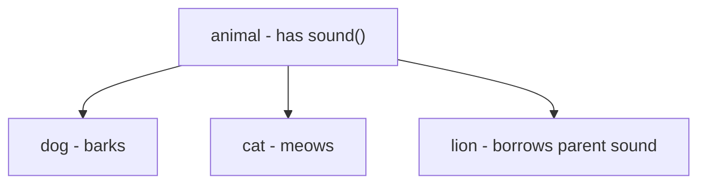
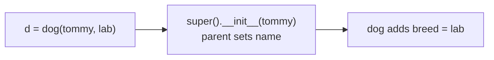
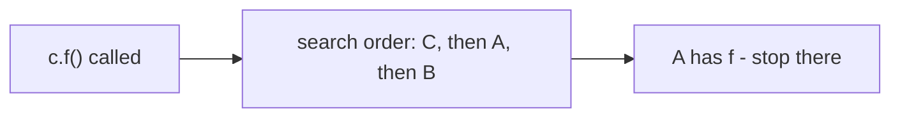
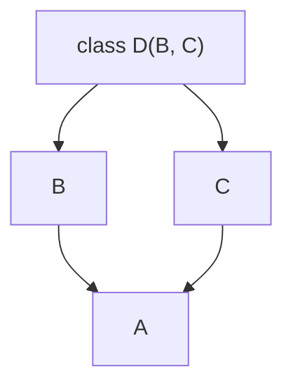

# Inheritance

> **Inheritance = a child class gets everything a parent has, then adds or replaces what it needs — Python finds every method by walking the MRO.**

Follows: [MASTER_TEACHING_STYLE.md](../../AGENT_STYLE/MASTER_TEACHING_STYLE.md) (Rule Sets 1 + 2 + 3)

## Status
- Status: New / Learning
- Prerequisites: [Classes & Objects](./01-classes-objects.md), [Encapsulation](./03-encapsulation.md), scope (LEGB)
- Last studied: Day 4
- Confidence: Building

---

## 🗺️ 0. Big Picture

| Question | Simple answer |
|---|---|
| **What is it?** | IS-A links: child inherits, adds to, or replaces parent behavior. |
| **Why does it exist?** | Copy-pasting the same code into every class rots fast — centralize it! |
| **What problem does it solve?** | Duplication; gives many classes ONE uniform surface. |
| **Where will you see it?** | sklearn `BaseEstimator` + mixins, PyTorch `nn.Module`, `Dataset`. |
| **What do you need first?** | Topics 01–03 (attributes, methods, encapsulation). |
| **Bigger picture** | OOP pillar #3 — the mechanism that makes polymorphism (topic 05) work. |

---

## 1. 🎯 Why should you care?

### The family analogy 👨‍👩‍👧‍👦

```text
        parent     (has: surname, house, stories)
           │
   ┌───────┴───────┐
   ↓               ↓
 child           child
 inherit everything,
 then add their own style
```

Children don't re-earn the surname — they're BORN with it. They just add their own things on top.

### You already wrote this in `poly.py`!

```python
class animal:                 #    parent
    def sound(self):
        print("animal sound")

class dog(animal):            #    child — "dog IS-A animal"
    def sound(self):
        print("dog barks")    # replaces parent's version

class cat(animal):            #    child
    def sound(self):
        print("cat meows")

class lion(animal):           #    child with NOTHING added
    pass                      # inherits parent's sound as-is!
```

### What inheritance gives you 🎁

```text
①    Reuse      → child gets ALL parent code for free
②    Extension  → add new methods/attributes on top
③    Overriding → replace parent behavior with your own
④    Uniformity → child objects count as parent objects
                  (this powers polymorphism — next topic!)
```

ML terms: every RandomForest is a subclass of sklearn's mixins; every PyTorch model subclasses `nn.Module`. **Inheritance is HOW all models share one fit/predict surface.**

---

## 2. 🧠 The mental model — IS-A

```text
animal      (parent / base / superclass)
   │
   ├── dog      — IS-A animal, but barks
   ├── cat      — IS-A animal, but meows
   └── lion     — IS-A animal, uses parent's sound as-is
```

**📊 Diagram — dog, cat, lion all come from animal**



```python
class dog(animal):     # read it as: "dog IS-A animal"
    ...
```

Key fact: **nothing is copied!** The child just LOOKS UP through the parent when it can't find something on itself.

---

## 3. 📖 Core concept — step by step

### 3.1 Basic inheritance

```python
class animal:
    def __init__(self, name):
        self.name = name
    def sound(self):
        print("generic animal sound")

class dog(animal):
    def sound(self):                       # override
        print("dog barks")

d = dog("tommy")
print(d.name)        # tommy     ← inherited __init__ (never defined in dog!)
d.sound()            # dog barks ← overridden version wins
```

Walk through it:

```text
dog("tommy")
   ↓
dog has no __init__ → look up MRO → found in animal ✅
   ↓
animal.__init__ runs → self.name = "tommy"

d.sound()
   ↓
dog HAS sound → use dog's version (child wins!) ✅
```

### 3.2 `super()` — call the parent's version ☎️

When the child overrides but STILL wants the parent's work:

```python
class dog(animal):
    def __init__(self, name, breed):
        super().__init__(name)      #    "parent, please set up name"
        self.breed = breed          # then add child-specific data
```

```text
dog.__init__("tommy", "lab")
        ↓
super().__init__("tommy")  →  animal.__init__ runs → name set ✅
        ↓
self.breed = "lab"         →  child adds its own ✅
```

**📊 Diagram — super() lets the parent set up first**



`super()` = "next class in the MRO" — never hardcode `animal.__init__(self,...)`; that breaks multiple inheritance.

### 3.3 Checking relationships 🕵️

```python
d = dog("tommy")

isinstance(d, dog)      # True  — d is a dog
isinstance(d, animal)   # True  — a dog IS-A animal ✅
isinstance(d, object)   # True  — everything in Python is an object!

issubclass(dog, animal) # True
issubclass(animal, dog) # False — parent is NOT a subclass of child
```

⚠ `isinstance` respects inheritance; `type(d) == animal` is False — exact match only!

### 3.4 Multiple inheritance — two parents 👨‍👩‍👧

```python
class A:
    def f(self): return "A"

class B:
    def f(self): return "B"
    def g(self): return "B.g"

class C(A, B):     # ⚠ order matters!
    pass

c = C()
print(c.f())       # "A"   ← A comes first in the list
print(c.g())       # "B.g" ← only B has g
```

Which `f` wins? The full answer is the MRO — next section.

---

## 4. 🔍 The MRO — Method Resolution Order (internals)

When you call `c.f()`, Python doesn't guess. It computes ONE linear search order:

```python
print(C.__mro__)
# (<class 'C'>, <class 'A'>, <class 'B'>, <class 'object'>)
```

```text
search order:  C  →  A  →  B  →  object
               │     │
               ❌    ✅ found! STOP here.
                     use A's f
```

**📊 Diagram — Python searches classes in a fixed order**



### C3 guarantees 📜

```text
✅ parents always come before their ancestors
✅ left parent searched before right parent
✅ no class ever appears twice
```

### The diamond 💎 — where people get lost

```python
class A: pass
class B(A): pass
class C(A): pass
class D(B, C): pass

print(D.__mro__)
# D → B → C → A → object
```

```text
          A
         / \
        B   C      ← both inherit from A
          \ /
           D
```

**📊 Diagram — two parents, one shared grandparent**



Notice: `A` appears ONCE, after BOTH `B` and `C` — not twice!

```text
D().f() lookup:
D ❌ → B ❌ → C ✅ → done
                ↑
     A visited exactly once, at the END
```

This is why `super()` (not hardcoded names) is safe in multiple inheritance — everyone cooperates along ONE chain.

### At three levels 🪜

```text
Level 1 (Simple):    child gets everything; can replace pieces it wants.
Level 2 (Precise):   nothing copied — lookup walks Child.__mro__ left to
                     right, first match wins; super() = NEXT class in MRO.
Level 3 (Advanced):  MRO computed by C3 linearization — local precedence kept,
                     parents before ancestors, no duplicates; diamonds are
                     deterministic and super() is cooperative.
```

---

## 5. 🔁 Overriding — the exact rules

```text
overriding = child defines a method with the SAME name
             ↓
child's version wins for CHILD objects
parent's version still exists:
  → for parent objects
  → via super()
```

```python
class lion(animal):
    pass                    # no override → inherits animal.sound

an = lion("leo")
an.sound()                  # generic animal sound ✅ (your poly.py did this!)
```

That's inheritance doing its job — nothing more mysterious than that.

---

## 6. ⚠️ Common mistakes

| Mistake ❌ | Why it hurts |
|---|---|
| Not calling `super().__init__()` in child | parent's setup never runs → silent `AttributeError` later |
| Hardcoding `animal.__init__(self, name)` | breaks multiple inheritance — skips other parents |
| Ignoring parent ORDER in multiple inheritance | first parent's method wins ties |
| Thinking `super()` = "direct parent" always | it follows the MRO — may skip sideways! |
| Using `type(x) == Class` instead of isinstance | breaks for subclasses — isinstance is inheritance-aware ✅ |
| Overriding `__init__`, losing parent setup | decide EVERY time: call super().__init__() or fully replace |

---

## 7. 🤖 ML connection

```text
sklearn      class MyModel(BaseEstimator, ClassifierMixin)
                 → get_params/set_params/score come FREE
PyTorch      class Net(nn.Module)
                 → parameter tracking, .to(device), .train()/.eval() free;
                   you only write __init__ and forward
datasets     class MyDataset(Dataset)
                 → inherit, implement __len__ + __getitem__, done
pattern      BaseModel with shared train/eval logic;
             each model overrides ONLY what differs
```

---

## 8. 🎯 PREDICT drills

Say your answer OUT LOUD first!

### Drill 1

```python
class A:
    def f(self): return "A"

class B(A):
    pass

b = B()
print(b.f())
```

**Answer:** `"A"` ✅ — B doesn't define f → MRO finds it in A.

### Drill 2 — trap ⚠️

```python
class A:
    def f(self): return "A"

class B(A):
    def f(self): return "B" + super().f()

print(B().f())
```

**Answer:** `"BA"` ✅ — override runs first, then calls parent via super().

```text
B().f()
  ↓ "B" + super().f()
  ↓        ↓
  ↓      A.f() → "A"
  ↓
"B"+"A" = "BA"
```

### Drill 3

```python
class A:
    def __init__(self):
        print("A init")

class B(A):
    def __init__(self):
        print("B init")       # ⚠ no super() call!

B()
```

**Answer:** `B init` only ✅ — overriding `__init__` WITHOUT super() means the parent constructor NEVER runs.

### Drill 4 — trickier (MRO)

```python
class A:
    def f(self): return "A"
class B:
    def f(self): return "B"
class C(A, B):
    pass

print(C.__mro__[1].__name__)
```

**Answer:** `A` ✅ — MRO: C → A → B → object. Position [1] after C is A.

### Drill 5 — the diamond 💎

```python
class A:
    def f(self): return "A"
class B(A): pass
class C(A):
    def f(self): return "C"
class D(B, C): pass

print(D().f())
```

**Answer:** `"C"` ✅

```text
MRO: D → B → C → A
D ❌ → B ❌ (no f) → C ✅ → C's f wins!
```

---

## 9. 🧪 Experiment

1. In `poly.py`, add `name` to animal's `__init__`; add `super().__init__(name)` to dog and cat. Verify `d.name` works.
2. Print `dog.__mro__` — see the chain yourself. Then build the diamond and print `D.__mro__`.
3. Add `describe()` to animal; call it on lion — inherited as-is.
4. Try `isinstance(lion_obj, animal)` and `issubclass(lion, animal)`.

---

## 10. 🎤 Interview questions

**Q: What is the MRO and how is it computed?**
Simple: the search order Python uses to find a method — parents before ancestors, left before right.
Stronger: a linearization of the hierarchy (C3 algorithm) — each class appears once, parents precede ancestors, left precedes right. `Class.__mro__` shows it; `super()` follows it.

**Q: Why call `super().__init__()`?**
Simple: to run the parent's setup.
Stronger: it calls the NEXT `__init__` in the MRO without hardcoding names — correct even under multiple inheritance — ensuring shared state exists before child-specific setup.

**Q: `isinstance` vs `type(x) == Class`?**
Simple: isinstance respects inheritance; type() wants an exact match.
Stronger: `isinstance(x, A)` is True for subclasses; `type(x) == A` only for exact A. Use isinstance — idiomatic and inheritance-aware.

**Q: What is the diamond problem?**
Simple: two parents sharing one grandparent — who runs, how many times?
Stronger: naive lookup could visit A twice. Python's C3 MRO visits A exactly once (D → B → C → A); super() cooperates along that chain — hardcoded parent calls break this.

---

## 11. 📄 Cheat sheet

```text
INHERITANCE & THE MRO
═══════════════════════════════════════
THE IDEA
→ class Child(Parent)   = "Child IS-A Parent"
→ reuse    + extend    + override

LOOKUP (the golden rule)
→ obj.attr  →  walk Child.__mro__ left→right
→           →  FIRST class that has it WINS
→ nothing is ever copied!

SUPER()
→ super().__init__(...)  = call NEXT class in MRO
→ never hardcode parent names

MULTIPLE INHERITANCE
→ class D(B, C)  — order matters ⚠
→ diamond: common base appears ONCE, at the end

CHECKS
→ isinstance(x, A) ✅ inheritance-aware
→ issubclass(B, A) — class-to-class

TRAP ⚠
→ override __init__ without super() → parent state never set
```

---

## ⭐ Key Takeaway

> **Nothing is copied in inheritance — lookup walks the MRO and the first match wins; `super()` follows that same chain, which is why it beats hardcoding parent names.**

---

## ✅ Progress

```text
WHAT YOU NOW KNOW:        IS-A reuse, overriding rules, super(),
                          multiple inheritance, MRO, the diamond
WHAT YOU SHOULD REMEMBER: lookup = walk __mro__, first match wins;
                          ALWAYS super().__init__();
                          isinstance > type() equality checks
WHAT WE LEARN NEXT:       topic 05 — polymorphism & duck typing
```

Next: [Polymorphism](./05-polymorphism.md)
