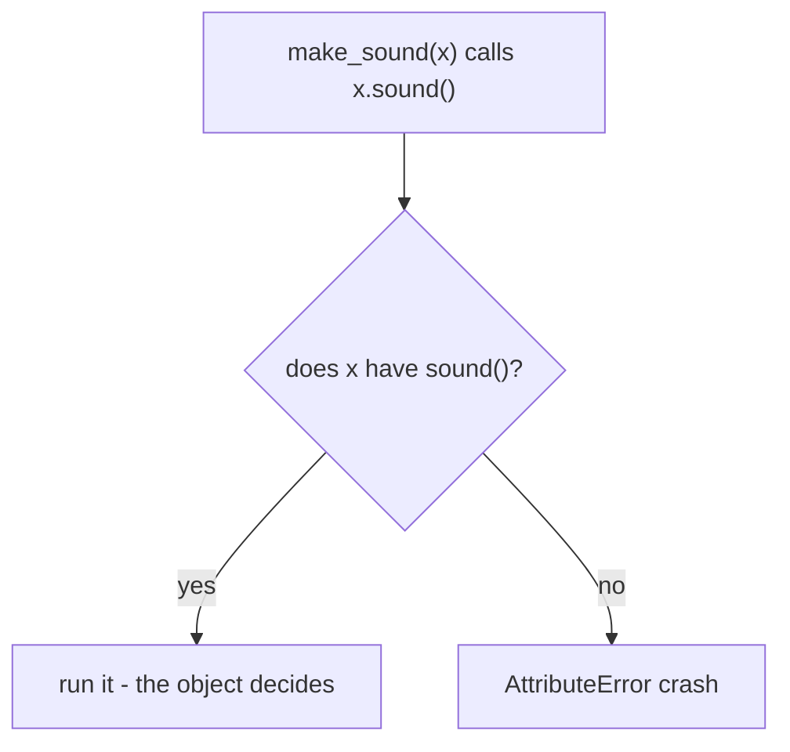
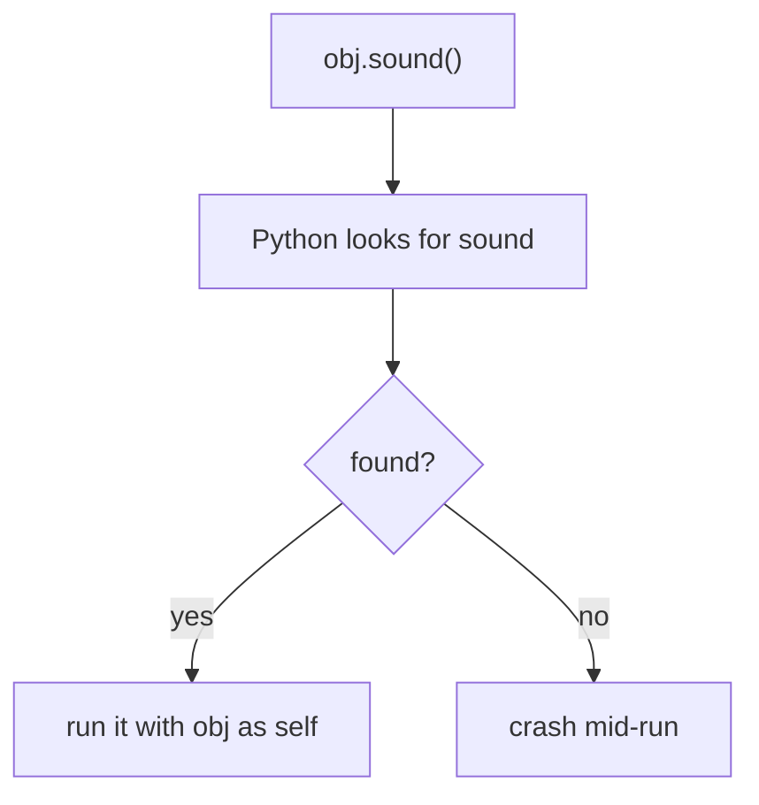
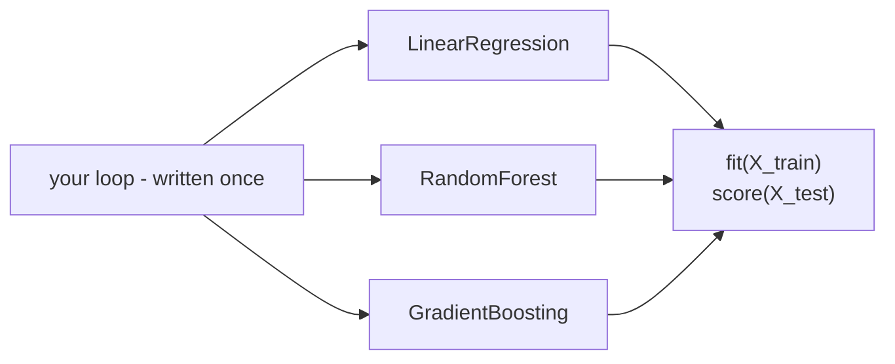

# Polymorphism

> **Polymorphism = one interface, many behaviors — you call `x.sound()` and the OBJECT decides what happens. In Python this is duck typing, resolved at runtime.**

Follows: [MASTER_TEACHING_STYLE.md](../../AGENT_STYLE/MASTER_TEACHING_STYLE.md) (Rule Sets 1 + 2 + 3)

## Status
- Status: New / Learning
- Prerequisites: [Inheritance](./04-inheritance.md), [Classes & Objects](./01-classes-objects.md)
- Last studied: Day 4
- Confidence: Building

---

## 🗺️ 0. Big Picture

| Question | Simple answer |
|---|---|
| **What is it?** | Same call, different behavior — depending on the object's real class. |
| **Why does it exist?** | Code that works over "anything with fit/predict" beats code rewritten per type. |
| **What problem does it solve?** | Kills `if isinstance(...)` sprawl and duplicated loops per class. |
| **Where will you see it?** | ONE sklearn loop trains ANY model; `model(x)` runs ANY architecture. |
| **What do you need first?** | Topic 04 (inheritance/overriding), topic 01. |
| **Bigger picture** | OOP pillar #4 — the payoff of inheritance; formalized by abstraction (topic 06). |

---

## 1. 🎯 Why should you care?

### The remote-control analogy 📺

```text
        YOU press the red button      (same action every time)
                    │
      ┌─────────────┼─────────────┐
      ▼             ▼             ▼
     TV           AC            Music
   changes       turns on      plays next
   channel       cooling       track

Same button. Different result — each device decides.
```

Your `poly.py` already contains exactly this:

```python
class dog:
    def sound(self):
        print("dog barks")

class lion:
    def sound(self):
        print("lion roars")

def make_sound(animal):
    animal.sound()          # ← the "red button"

l = lion()
d = dog()
make_sound(d)     # dog barks
make_sound(l)     # lion roars
```

ONE function works with TWO completely different classes. It never asks *"are you a dog or a lion?"* — it just calls `.sound()` and the object decides.

> **Poly = many, morph = forms. One call → many behaviors.**

This is THE most important OOP idea for ML: **one evaluation loop that trains ANY model**, because every model exposes `fit` / `predict`.

---

## 2. 🧠 The mental model

```text
make_sound(animal)
      │
      └── animal.sound()   ← the ONLY thing the function knows
              │
      ┌───────┴────────┐
      ▼                ▼
   dog.sound()      lion.sound()
   "dog barks"      "lion roars"
```

- The caller cares about ONE thing only: **can it do `sound()`?**
- The OBJECT decides HOW it happens.

This works because Python is **dynamically typed** — no compile-time check of what `animal` is. Any object with a `sound` method is welcome.

---

## 3. 📖 The three forms in Python

### 3.1 Duck typing 🦆 (the Pythonic way)

> *"If it walks like a duck and quacks like a duck... it's a duck."*

```python
def make_sound(animal):
    animal.sound()      # no type check, no inheritance needed!
```

`dog` and `lion` don't even need a common parent — your first `poly.py` block proved it. The ONLY requirement:

```text
the object must have a callable .sound ✅
```

If it doesn't:

```python
make_sound(42)      # ❌ AttributeError: 'int' object has no attribute 'sound'
```

**📊 Diagram — duck typing: just call and see**



⚠ The error appears AT RUNTIME — at the moment of the call, not before.

### 3.2 Method overriding 🔁 (with inheritance)

```python
class animal:
    def sound(self):
        print("animal sound")

class dog(animal):
    def sound(self):
        print("dog barks")

class cat(animal):
    def sound(self):
        print("cat meows")

an = dog()
an.sound()      # dog barks ← override wins
an = cat()
an.sound()      # cat meows ← same variable, new object, new behavior!
```

Same name `sound`, different behavior per class. The variable `an` happily holds different types — Python doesn't mind.

### 3.3 Operator overloading ➕

Operators are polymorphic too! `+` means different things per type:

```text
1 + 2        → 3           (numbers: add)
"a" + "b"    → "ab"        (strings: glue)
[1] + [2]    → [1, 2]      (lists: merge)
```

Same symbol, many behaviors — dispatch happens through magic methods (`__add__` — next topic!).

---

## 4. 🔍 What happens at call time (internals)

```python
animal.sound()      # i.e., obj.sound()
```

```text
① look up "sound" on the OBJECT (via MRO if inheritance involved)
        ↓ found?
② bind it (pass obj as self) and CALL it ✅
        ↓ not found?
③ AttributeError at RUNTIME ❌
```

**📊 Diagram — what happens during obj.sound()**



No type checking happens BEFORE the call. That's the whole difference from Java/C++:

```text
Java/C++   :  compile-time check → wrong type = won't compile
Python     :  runtime lookup     → wrong type = crashes mid-run
```

### ⚠️ The cost of freedom

Wrong object fails LATE — when the pipeline is already running. In ML pipelines:

```python
assert hasattr(obj, "fit")     # cheap early check ✅ beats a confusing
                               # traceback 3 hours into training 😱
```

### At three levels 🪜

```text
Level 1 (Simple):    same method name, different classes, different results.
Level 2 (Precise):   dispatch at call time via attribute lookup (MRO if
                     inherited); zero type checks anywhere.
Level 3 (Advanced):  duck typing = structural typing at runtime;
                     typing.Protocol verifies the same shape statically;
                     operator overloading rides the dunder protocol.
```

---

## 5. ⚠️ Common mistakes

| Mistake ❌ | Why it hurts |
|---|---|
| `if isinstance(x, dog):...` everywhere | defeats the whole point — stop asking types, trust behavior! |
| Assuming duck typing when method missing | `AttributeError` at runtime, deep in a pipeline |
| Naming methods differently (`sound`/`speak`/`makeSound`) | duck typing needs the SAME name across classes |
| `type(x) == dog` instead of isinstance | breaks subclasses — exact checks kill polymorphism |
| Forcing polymorphism on unrelated things | fake interfaces confuse everyone — keep unrelated classes unrelated |

---

## 6. 🤖 ML connection (the deepest one!)

```python
models = [LinearRegression(), RandomForestClassifier(), GradientBoostingClassifier()]

for model in models:                  # ONE loop
    model.fit(X_train, y_train)       # each model does it ITS way
    acc = model.score(X_test, y_test)
    print(type(model).__name__, acc)
```

```text
        ┌──────────────────────────┐
        │   your evaluation loop   │  written ONCE
        └──────────────────────────┘
           │           │           │
           ▼           ▼           ▼
      LinearReg    RandomForest   GradBoost
      fit/score    fit/score      fit/score
      (its way)    (its way)      (its way)
```

**📊 Diagram — one loop trains every model**



**Every sklearn estimator speaks the same interface** (`fit`, `predict`, `score`) — that's polymorphism powering model comparison.

Same idea everywhere:

- PyTorch: `model(x)` over any architecture — ResNet, Transformer, your Net
- Custom datasets: `len(ds)` and `ds[i]` over any dataset class
- Evaluation harnesses: write once, run on any model

And sklearn's version of duck typing: plug in a custom class as long as it implements `fit`/`predict` — sklearn checks BEHAVIOR, not ancestry.

---

## 7. 🎯 PREDICT drills

Say your answer OUT LOUD first!

### Drill 1

```python
class bird:
    def sound(self): print("chirp")
class frog:
    def sound(self): print("ribbit")

for x in [bird(), frog()]:
    x.sound()
```

**Answer:** `chirp` then `ribbit` ✅ — duck typing in a loop.

### Drill 2 — trap ⚠️

```python
def call(x):
    return x.area()

call("hello")
```

**Answer:** `AttributeError: 'str' object has no attribute 'area'` ❌ — runtime failure, no warning beforehand.

### Drill 3

```python
class A:
    def f(self): return "A"
class B(A):
    def f(self): return "B"
class C(A): pass

for obj in [A(), B(), C()]:
    print(obj.f(), end=" ")
```

**Answer:** `A B A` ✅ — B overrides, C inherits from A.

### Drill 4 — trickier

```python
def add(a, b):
    return a + b

print(add(2, 3))
print(add("2", "3"))
print(add([1], [2]))
```

**Answer:** `5`, `"23"`, `[1, 2]` ✅ — operator overloading IS polymorphism: same function, different types, different results.

### Drill 5 — the duck trap 🦆

```python
class duck:
    def quack(self): print("quack")
class dog:
    def bark(self): print("bark")

def let_it_quack(x):
    x.quack()

let_it_quack(duck())   # works ✅
let_it_quack(dog())    # ???
```

**Answer:** `AttributeError` ❌ — a dog has no `quack`. Duck typing demands the EXACT interface, not a similar one.

---

## 8. 🧪 Experiment

1. In `poly.py`, add a `snake` class with `sound()` = hiss; pass it to `make_sound`. NO other changes needed.
2. Add a `shark` to the inheritance block with NO `sound` — call it; watch the parent's sound come through (topic 04 at work).
3. Write `pay(payment_method)` working for `CreditCard` and `UPI` classes (both have `.pay`) — a mini real system.
4. Pass an integer to `make_sound`; read the traceback carefully — see exactly WHERE Python fails.

---

## 9. 🎤 Interview questions

**Q: What is polymorphism in Python?**
Simple: same interface, different behaviors per object.
Stronger: one call (`obj.method()`) dispatches to different implementations based on the object's actual class. In Python it's runtime + structural (duck typing) — the object just needs the right method; there are NO compile-time checks.

**Q: Explain duck typing with an example.**
Simple: if it has the method, use it — who cares about type.
Stronger: `len()` works on anything with `__len__`; a function calling `x.quack()` works for any object having `quack`. Behavior matters, ancestry doesn't. Failure = `AttributeError` at runtime.

**Q: Polymorphism vs inheritance — how do they relate?**
Simple: inheritance is the mechanism; polymorphism is the behavior it enables.
Stronger: inheritance enables override-based polymorphism (MRO dispatch). Duck typing enables polymorphism with NO inheritance at all. Both deliver "one interface, many behaviors."

**Q: How does sklearn exploit polymorphism?**
Every estimator implements fit/predict/score (via mixins + duck typing), so loops, Pipelines, and GridSearchCV work uniformly across ALL models — swap LinearRegression for XGBoost with ZERO loop changes.

---

## 10. 📄 Cheat sheet

```text
POLYMORPHISM
═══════════════════════════════════════
THE IDEA
→ one interface   , many behaviors
→ caller says WHAT; object decides HOW

THREE FORMS
→ duck typing      (no inheritance needed!)
→ overriding       (child replaces parent)
→ operators        (+ - * via dunders)

GOLDEN RULES
→ Python checks NOTHING upfront
→ missing methods fail at RUNTIME ⚠
→ same method NAME across classes = the contract

ML CONNECTION
→ one loop → any sklearn model
→ model(x) → any architecture

TRAP ⚠
→ isinstance-checking everywhere defeats the point
```

---

## ⭐ Key Takeaway

> **The caller states the interface, the object supplies the behavior — Python checks nothing upfront, so missing methods fail at runtime.**

---

## ✅ Progress

```text
WHAT YOU NOW KNOW:        duck typing, override-based polymorphism,
                          operator overloading, the cost of dynamic dispatch
WHAT YOU SHOULD REMEMBER: one interface, many behaviors; never
                          isinstance-spray your pipeline; SAME method
                          name across classes = the contract
WHAT WE LEARN NEXT:       topic 06 — abstraction (enforced duck typing!)
```

Next: [Abstraction](./06-abstraction.md)
