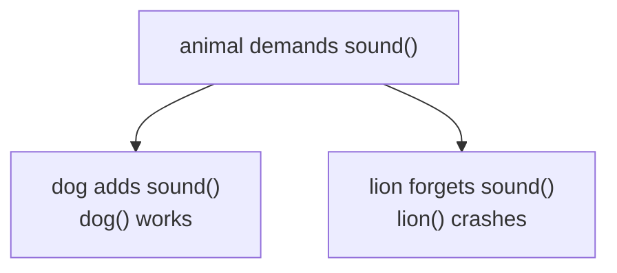
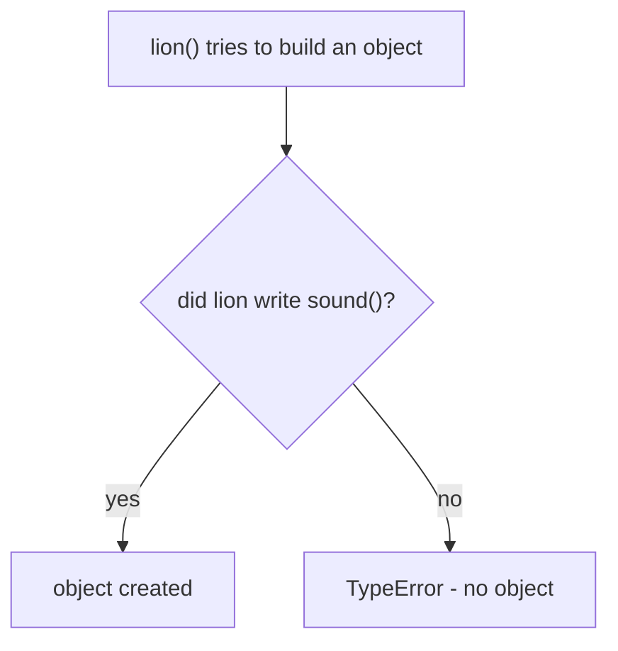
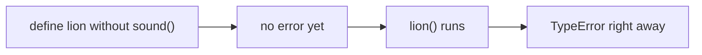

# Abstraction

> **Abstraction = declare WHAT every subclass must do (`@abstractmethod`), let each subclass decide HOW — broken promises fail INSTANTLY with a TypeError, not deep inside your pipeline.**

Follows: [MASTER_TEACHING_STYLE.md](../../AGENT_STYLE/MASTER_TEACHING_STYLE.md) (Rule Sets 1 + 2 + 3)

## Status
- Status: New / Learning
- Prerequisites: [Inheritance](./04-inheritance.md), [Polymorphism](./05-polymorphism.md)
- Last studied: Day 4
- Confidence: Building

---

## 🗺️ 0. Big Picture

| Question | Simple answer |
|---|---|
| **What is it?** | Formal contracts: abstract base classes listing required methods. |
| **Why does it exist?** | Duck typing fails late & silently — abstraction makes the contract explicit and early-failing. |
| **What problem does it solve?** | "Forgot `sound()`" found inside a training loop → now caught the moment you write `dog()`. |
| **Where will you see it?** | sklearn `BaseEstimator`, PyTorch `nn.Module.forward`, PyTorch `Dataset`. |
| **What do you need first?** | Topics 04–05 (inheritance, polymorphism). |
| **Bigger picture** | OOP pillar #5 — enforced duck typing; the design tool behind every ML framework API. |

---

## 1. 🎯 Why should you care?

### The job-contract analogy 📋

```text
Duck typing (topic 05):
   "Just show up and do the work"
   → if someone forgets a skill, you find out ON THE JOB

Abstraction:
   "Sign this contract FIRST: you MUST know how to sound()"
   → no signature, no job. Instant rejection. ✅
```

Last topic's duck typing was **implicit** — forget to implement `sound()` and nothing complains until runtime, deep inside a call.

Abstraction makes the contract **EXPLICIT**:

> **Abstraction = defining WHAT an interface must do, without saying HOW.**

### What you gain 🎁

```text
①    Guaranteed contract → forgetting a method fails at CREATION time,
                            not deep in a pipeline
②    Design clarity      → the interface lives in ONE visible place
③    Safe polymorphism   → duck typing becomes ENFORCED duck typing
```

sklearn's `BaseEstimator` and PyTorch's `nn.Module` both work exactly like this: they define the shape of the contract; YOU fill in the implementation.

---

## 2. 🧠 The mental model

```text
        abstract class     (the CONTRACT)
        "every Animal MUST be able to sound()"
                    │
        ┌───────────┼───────────┐
        ▼           ▼           ▼
       dog          cat         lion
    implements    implements   forgot! ❌
     sound()       sound()    → CANNOT be created
    ✅ instantiable  ✅ ok        (TypeError!)
```

- The abstract class CANNOT be instantiated — it's a blueprint of a blueprint
- Subclasses MUST implement the abstract methods — or stay abstract themselves
- Users only ever see the contract — never the implementation details

---

## 3. 📖 Core concept — step by step

```python
from abc import ABC, abstractmethod

class animal(ABC):              #    declare: "I am a contract"
    @abstractmethod
    def sound(self):
        pass                    # no body — just the promise

class dog(animal):
    def sound(self):
        print("dog barks")      # promise KEPT ✅

class lion(animal):
    pass                        # ❌ promise BROKEN — still abstract!
```

**📊 Diagram — dog keeps the promise, lion forgets**



### The rules table 📜

| Thing | Behavior |
|---|---|
| `class animal(ABC)` | declares an abstract base class |
| `@abstractmethod` | marks the method as REQUIRED |
| `dog(animal)` implementing `sound` | **concrete** ✅ — can be instantiated |
| `lion(animal)` without `sound` | **still abstract** ❌ — cannot be instantiated |
| `animal()` directly | `TypeError` — contracts can't become objects |

### See the enforcement 🔥

```python
d = dog()      # ✅ works — promise kept
a = animal()   # ❌ TypeError: Can't instantiate abstract class animal
               #    with abstract method sound
l = lion()     # ❌ TypeError — lion never implemented sound
```

**That is the win:** forgetting a method is caught at INSTANTIATION time — when you first touch the class. Not later when some downstream code calls a missing method in the middle of training.

---

## 4. 🔍 How Python enforces it (internals)

### The machinery ⚙️

`ABC` uses a special metaclass called `ABCMeta`. When you mark a method with `@abstractmethod`, Python records it in a set on the class:

```python
print(animal.__abstractmethods__)   # frozenset({'sound'})
```

### The check happens HERE 👇

```text
instantiate X          (e.g., dog())
        ↓
X.__abstractmethods__ empty?
        │
   ┌────┴─────┐
   YES        NO
   ↓          ↓
 allow ✅    TypeError ❌
             "Can't instantiate abstract class X"
```

**📊 Diagram — the check happens when you build the object**



- subclass implements `sound` → its `__abstractmethods__` is EMPTY → instantiable ✅
- subclass forgets → set stays NON-empty → abstract forever ❌

### WHERE enforcement fires (important!) 📍

```text
at CLASS DEFINITION time?   ❌ no error yet
at INSTANTIATION time?      ✅ TypeError fires HERE
at METHOD CALL time?        ❌ too late — never reached
```

**📊 Diagram — forgetting a method fails instantly**



The moment `dog()` runs, Python checks `dog.__abstractmethods__`. That's it!

### Abstract classes CAN have real methods too 💡

```python
class animal(ABC):
    @abstractmethod
    def sound(self): ...            # the CONTRACT part

    def describe(self):             # the SHARED part
        print("I am an animal")

class dog(animal):
    def sound(self):
        print("dog barks")

d = dog()
d.describe()      # I am an animal ← inherited concrete method ✅
```

```text
abstract class = contract     +  shared code
                 (must implement)  (comes free)
```

### At three levels 🪜

```text
Level 1 (Simple):    abstract class = contract; subclasses fill it in.
Level 2 (Precise):   ABCMeta records required names in __abstractmethods__;
                     instantiation raises TypeError while that set is
                     non-empty.
Level 3 (Advanced):  ABCs = nominal (inheritance-based) contracts;
                     typing.Protocol = structural ones; abstract methods can
                     carry docstrings + super() scaffolding for subclasses.
```

---

## 5. ⚠️ Common mistakes

| Mistake ❌ | Why it hurts |
|---|---|
| Forgetting `ABC` in the base class | `@abstractmethod` silently does NOTHING — no enforcement! |
| Instantiating the abstract class | `TypeError` — by design, that's the feature |
| Subclass forgetting abstract methods | also `TypeError` at instantiation — that's the POINT |
| Putting real logic in abstract methods | they're contracts, not defaults |
| Using abstraction for a tiny one-off class | over-engineering — use it when there are MULTIPLE implementations |
| Thinking abstract classes can't have code | they CAN — shared logic lives in the base |

---

## 6. 🤖 ML connection

```text
sklearn      BaseEstimator        → contract: get_params/set_params;
                                    custom models add fit/predict
PyTorch      nn.Module            → forward() is YOUR abstract method;
                                    __call__ handles all machinery
datasets     Dataset              → requires __len__ + __getitem__;
                                    missing one fails at first use, loudly
your code    BaseModel(ABC)       → abstract train()/predict();
                                    every model inherits the contract;
                                    evaluation code stays model-agnostic
```

---

## 7. 🎯 PREDICT drills

Say your answer OUT LOUD first!

### Drill 1

```python
from abc import ABC, abstractmethod

class shape(ABC):
    @abstractmethod
    def area(self): ...

shape()
```

**Answer:** `TypeError` ❌ — abstract classes can't be instantiated.

### Drill 2

```python
class circle(shape):
    def area(self):
        return 3.14 * 1 * 1

print(circle().area())
```

**Answer:** `3.14` ✅ — contract implemented → instantiable.

### Drill 3 — trap ⚠️

```python
class square(shape):
    pass

square()
```

**Answer:** `TypeError` ❌ — square never implemented `area` → still abstract.

### Drill 4 — trickier

```python
class animal(ABC):
    @abstractmethod
    def sound(self): ...
    def info(self):                 # concrete method
        return "animal"

class dog(animal):
    def sound(self):
        return "woof"

d = dog()
print(d.info(), d.sound())
```

**Answer:** `animal woof` ✅ — concrete inherited + abstract implemented. Both coexist happily.

### Drill 5

```python
class vehicle(ABC):
    @abstractmethod
    def move(self): ...

class car(vehicle):
    def move(self): return "driving"

class boat(vehicle):
    def move(self): return "sailing"

for v in [car(), boat()]:
    print(v.move(), end=" ")
```

**Answer:** `driving sailing` ✅ — abstraction + polymorphism holding hands: one interface, different implementations.

---

## 8. 🧪 Experiment

1. Build `shape(ABC)` with abstract `area()` AND `perimeter()`; make `circle` (implements both) and `rectangle` (implements one). Try instantiating the incomplete one.
2. Print `shape.__abstractmethods__` and subclass versions — watch the set SHRINK as methods get implemented.
3. Add concrete `describe()` to `shape`; call it from a subclass.
4. Define a class WITHOUT `ABC` but WITH `@abstractmethod` — observe... nothing happens. Silent danger! ⚠

---

## 9. 🎤 Interview questions

**Q: Abstraction vs encapsulation?**
Simple: abstraction hides HOW it works; encapsulation protects the DATA.
Stronger: abstraction defines a contract hiding fulfillment details; encapsulation guards internal state via controlled access. A class uses both: public abstract interface outside, private validated state inside.

**Q: How does Python enforce abstraction?**
Simple: `ABC` + `@abstractmethod` → instantiating an incomplete class raises TypeError.
Stronger: `ABCMeta` metaclass records abstract names in `__abstractmethods__`; instantiation checks the set and raises TypeError if non-empty. A subclass becomes instantiable only after implementing everything.

**Q: Abstract class vs interface — does Python distinguish?**
Simple: not formally — ABCs play both roles.
Stronger: no `interface` keyword. An ABC with only abstract methods ≈ an interface; with concrete methods too ≈ classic abstract class. `typing.Protocol` is the structural alternative.

**Q: Why is instantiation-time failure better than runtime failure?**
An incomplete subclass dies the moment you create it — at development time, right next to the mistake. Pure duck typing surfaces the failure LATER — possibly inside a training loop over thousands of objects.

---

## 10. 📄 Cheat sheet

```text
ABSTRACTION
═══════════════════════════════════════
THE IDEA
→ define WHAT   , hide HOW
→ enforced duck typing

SYNTAX
→ from abc import ABC, abstractmethod
→ class animal(ABC):
→     @abstractmethod
→     def sound(self): ...
→ class dog(animal): def sound(self): ...

ENFORCEMENT
→ check fires at INSTANTIATION time only
→ __abstractmethods__ non-empty → TypeError ❌
→ implement everything → set empties → instantiable ✅

GOLDEN RULES
→ no ABC base → @abstractmethod is INERT ⚠
→ abstract classes CAN have concrete shared methods

ML CONNECTION
→ nn.Module.forward · sklearn BaseEstimator · Dataset
```

---

## ⭐ Key Takeaway

> **Abstraction turns duck typing into an enforced contract — incomplete subclasses die instantly at instantiation instead of failing later inside your pipeline.**

---

## ✅ Progress

```text
WHAT YOU NOW KNOW:        ABC + @abstractmethod, __abstractmethods__,
                          when TypeError fires, mixing abstract +
                          concrete methods
WHAT YOU SHOULD REMEMBER: no ABC → no enforcement ⚠;
                          enforcement = instantiation time only;
                          contract    + shared code    can coexist
WHAT WE LEARN NEXT:       topic 07 — magic (dunder) methods
```

Next: [Magic (Dunder) Methods](./07-magic-methods.md)
