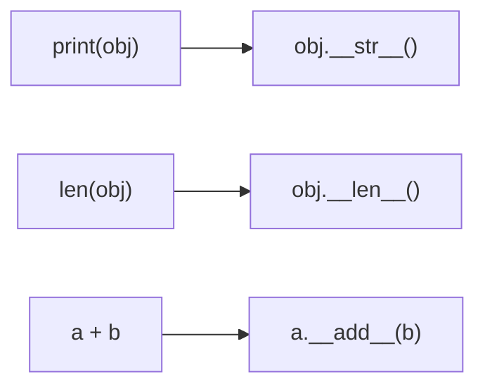
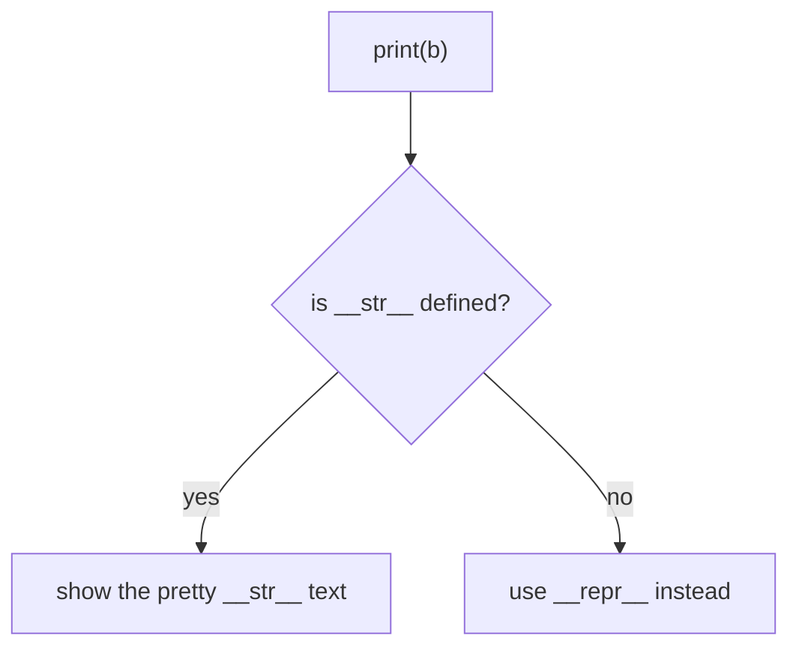
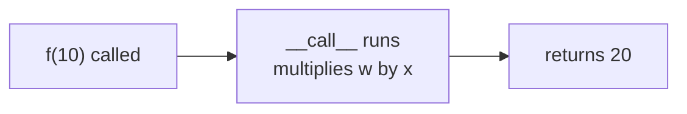
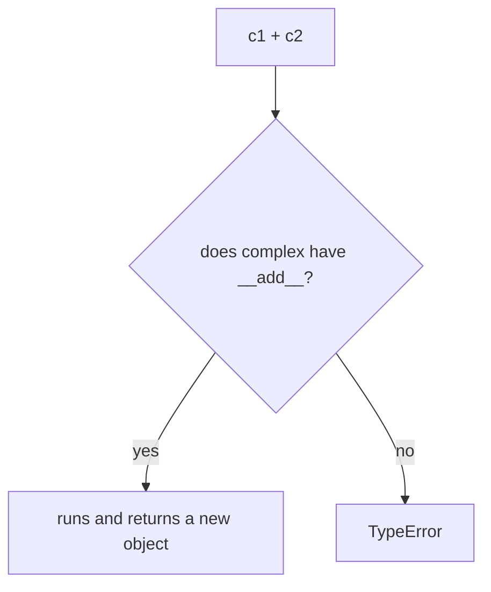

# Magic (Dunder) Methods

> **Magic (dunder) methods are secret hooks Python calls when you use normal syntax — print, len, ==, +, indexing, calling — so YOUR objects behave like Python natives.**

Follows: [MASTER_TEACHING_STYLE.md](../../AGENT_STYLE/MASTER_TEACHING_STYLE.md) (Rule Sets 1 + 2 + 3)

## Status
- Status: New / Learning
- Prerequisites: [Classes & Objects](./01-classes-objects.md), [Polymorphism](./05-polymorphism.md)
- Last studied: Day 4
- Confidence: Building

---

## 🗺️ 0. Big Picture

| Question | Simple answer |
|---|---|
| **What is it?** | Double-underscore methods Python auto-calls for built-in syntax. |
| **Why does it exist?** | ONE uniform syntax (`+`, `len`, `for`, `with`) must work on every type — yours too! |
| **What problem does it solve?** | Custom classes being second-class citizens no operator understands. |
| **Where will you see it?** | `len(dataset)`, `dataset[i]`, `model(x)` via `__call__`, sklearn's pretty `__repr__`. |
| **What do you need first?** | Topics 01, 05 (objects, polymorphism). |
| **Bigger picture** | The protocol layer under EVERYTHING — iterators, context managers, callables are all dunders. |

---

## 1. 🎯 Why should you care?

### The adapter-plug analogy 🔌

```text
Python's syntax = the wall socket
your class      = your device

no dunders:  plug doesn't fit → TypeError everywhere ❌
with dunders: perfect fit → print, len, +, == all just WORK
```

Your `dunder.py` already showed the dream:

```python
b1 = Book("Python", 300)
print(b1)        # Book : Python, Pages : 300   ← custom printing!
print(len(b1))   # 300                          ← len() works on YOUR object!
print(b1 == b2)  # False                        ← == uses YOUR rule!
```

Without magic methods, all of this fails or is useless:

```python
print(b1)        # <__main__.Book object at 0x...>  ← useless
len(b1)          # ❌ TypeError: object of type 'Book' has no len()
b1 == b2         # False even for IDENTICAL books ← compares identity only
```

Every serious ML library leans on this:

- `len(dataset)` and `dataset[i]` → custom datasets
- `model(x)` → neural networks are *called* like functions
- `print(model)` → nice model summaries

---

## 2. 🧠 The mental model

You write normal syntax. Python secretly translates it:

```text
you write:            Python secretly calls:
─────────────────────────────────────────────
print(obj)       →    obj.__str__()
len(obj)         →    obj.__len__()
obj == other     →    obj.__eq__(other)
obj + other      →    obj.__add__(other)
str(obj)         →    obj.__str__()
repr(obj)        →    obj.__repr__()
obj[i]           →    obj.__getitem__(i)
iter(obj)        →    obj.__iter__()
obj(x)           →    obj.__call__(x)
x in container   →    container.__contains__(x)
```

**📊 Diagram — normal code quietly calls dunders**



You NEVER call `obj.__str__()` yourself. You write `print(obj)` — Python does the dispatch for you.

---

## 3. 📖 The essential dunders — step by step

### 3.1 `__str__` vs `__repr__` — the two faces 🎭

```python
class Book:
    def __init__(self, name, pages):
        self.Name = name
        self.Pages = pages

    def __str__(self):                      # for HUMANS
        return f"Book : {self.Name}, Pages : {self.Pages}"

b = Book("Python", 300)
print(b)        # Book : Python, Pages : 300
```

| Method | Audience | Used by |
|---|---|---|
| `__repr__` | developers — unambiguous, ideally re-creatable | `repr(obj)`, interactive console |
| `__str__` | users — pretty and readable | `print(obj)`, `str(obj)` |

```text
print(b) flow:
print(b) → __str__ exists? → use it ✅
                 ↓ missing?
           fall back to __repr__ ✅
(reverse fallback? NEVER ❌)
```

**📊 Diagram — print falls back to __repr__**



```python
def __repr__(self):
    return f"Book('{self.Name}', {self.Pages})"

print(str(b))     # Book : Python, Pages : 300   ← __str__ wins for print
print(repr(b))    # Book('Python', 300)          ← developer view
```

### 3.2 `__len__` — make `len()` work 📏

```python
class Team:
    def __init__(self, members):
        self.members = members
    def __len__(self):
        return len(self.members)

t = Team(["virat", "rohit", "gill"])
print(len(t))    # 3
```

Bonus: an object with `__len__` is also truthy/falsy by length (`0` = falsy!).

### 3.3 `__eq__` — make `==` mean what YOU want ⚖️

```python
class Student:
    def __init__(self, name, roll):
        self.name = name
        self.roll = roll
    def __eq__(self, other):
        return self.roll == other.roll     # MY rule: same roll = equal

s1 = Student("Adarsh", 101)
s2 = Student("Rahul", 101)
print(s1 == s2)    # True — same roll number ✅
```

Without `__eq__`, `==` compares IDENTITY (same object in memory):

```text
default:  s1 == s2  →  "are these the SAME object?"  → False
with __eq__:  "do they mean the same thing?"         → True ✅
```

### 3.4 `__add__` — operators become yours ➕

```python
class Complex:
    def __init__(self, real, img):
        self.real = real
        self.img = img
    def __add__(self, other):
        return Complex(self.real + other.real, self.img + other.img)
    def __str__(self):
        return f"{self.real} + {self.img}j"

c1 = Complex(2, 3)
c2 = Complex(4, 5)
print(c1 + c2)     # 6 + 8j
```

---

## 4. 🔧 Fixing your `poly.py` bug — the broken `__add__`

Your `poly.py` ended with this:

```python
class complex:
    def __init__(self, real, img):
        self.real = real
        self.img = img
    def __add__(self, other):
        rp = self.real + other.real
        ip = self.real + other.img      # ❌ BUG 1: self.real, not self.img!
        # ❌ BUG 2: no return statement!
```

### Bug 1 — wrong attribute ❌

```text
ip = self.real + other.img
        ↑ real + imaginary = meaningless number!
should be:
ip = self.img + other.img   (imaginary + imaginary ✅)
```

Silent bug — runs fine, WRONG answer. The scariest kind.

### Bug 2 — no return ❌

```text
c1 + c2  →  __add__ runs... returns NOTHING → None!
print(c1 + c2)  →  None
```

### The fixed version ✅

```python
class complex:
    def __init__(self, real, img):
        self.real = real
        self.img = img
    def __add__(self, other):
        rp = self.real + other.real
        ip = self.img + other.img
        return complex(rp, ip)       # ← return a NEW complex! ✅
    def __str__(self):
        return f"{self.real} + {self.img}j"

c1 = complex(10, 40)
c2 = complex(13, 10)
print(c1 + c2)     # 23 + 50j ✅
```

**The rule:** operator methods RETURN A NEW OBJECT — they never mutate `self`.

```text
c1 + c2 should never change c1!
(like 2 + 3 doesn't change what 2 means   )
```

---

## 5. 🪝 More dunders you'll meet constantly

| Dunder | Trigger | Typical use |
|---|---|---|
| `__getitem__(self, i)` | `obj[i]` | custom datasets: `dataset[42]` |
| `__setitem__` | `obj[i] = v` | structured stores |
| `__iter__` | `for x in obj` | make objects iterable |
| `__contains__` | `x in obj` | membership logic |
| `__call__` | `obj(args)` | PyTorch: `model(x)` |
| `__enter__` / `__exit__` | `with obj:` | context managers (files!) |
| `__bool__` | `if obj:` | custom truthiness |
| `__hash__` | `hash(obj)` | dict keys/sets (must pair with `__eq__`) |
| `__lt__` / `__le__`... | `<`, `<=` | sorting custom objects |

### `__call__` — the one behind neural networks ☎️

```python
class Linear:
    def __init__(self, w):
        self.w = w
    def __call__(self, x):
        return self.w * x

f = Linear(2)
print(f(10))    # 20 ← the OBJECT is called like a FUNCTION!
```

**📊 Diagram — calling an object like a function**



This is EXACTLY how PyTorch's `model(x)` works — `nn.Module.__call__` wraps your `forward`.

---

## 6. 🔍 How dispatch happens (internals)

```python
c1 + c2
```

```text
① look for __add__ on the CLASS of the LEFT operand (c1's class)
        ↓ found?
② call complex.__add__(c1, c2) ✅
        ↓ not found?
③ try the REFLECTED version __radd__ on the RIGHT operand
        ↓ neither?
④ TypeError: unsupported operand type(s) for + ❌
```

**📊 Diagram — what a + b secretly runs**



Key facts:

- Dunders are looked up **on the TYPE**, not the instance — a dunder in the instance `__dict__` is IGNORED. (Deliberate — stops spoofing built-ins)
- `print(obj)` → `__str__`; missing → falls back to `__repr__`
- `==` without `__eq__` → identity (`is`)

### At three levels 🪜

```text
Level 1 (Simple):    define __str__/__len__/__add__ → normal syntax
                     starts working on your objects.
Level 2 (Precise):   syntax triggers implicit dispatch: print→__str__
                     (fallback __repr__), len→__len__, ==→__eq__,
                     +→__add__ then __radd__; lookup is on the TYPE.
Level 3 (Advanced):  dunders implement the data-model protocols (iterable,
                     callable, context manager, hashable); overriding
                     __eq__ sets __hash__ to None unless both are defined.
```

---

## 7. ⚠️ Common mistakes

| Mistake ❌ | Why it hurts |
|---|---|
| `__add__` without `return` | result is `None` — silent and confusing |
| `__add__` mutating `self` | `a + b` must NOT change `a`! |
| Defining `__eq__` without `__hash__` | object becomes UNHASHABLE — breaks dict keys/sets |
| Thinking `__str__` falls back from `__repr__` | backwards! `__str__`→`__repr__` only, never reverse |
| Wrong attribute names in dunder math (your poly.py bug!) | wrong results, NO error |
| Defining dunders on the INSTANCE | silently ignored — dispatch is class-level |

---

## 8. 🤖 ML connection

```text
PyTorch datasets      __len__ + __getitem__ → the WHOLE DataLoader
                      runs on just these two dunders!
nn.Module             model(x) → __call__ dispatches to forward
sklearn               printing a model shows LinearRegression()
                      — that's a hand-written __repr__
metrics               accuracy(y_pred, y_true) → metric object
                      called like a function via __call__
containers            len/indexing/in on your data structures
```

---

## 9. 🎯 PREDICT drills

Say your answer OUT LOUD first!

### Drill 1

```python
class Num:
    def __init__(self, v):
        self.v = v
    def __str__(self):
        return f"Num({self.v})"
    def __repr__(self):
        return f"Num(v={self.v})"

n = Num(5)
print(str(n))
print(repr(n))
```

**Answer:** `Num(5)` then `Num(v=5)` ✅ — `str()` uses `__str__`; `repr()` uses `__repr__`.

### Drill 2 — trap ⚠️

```python
class Box:
    def __init__(self, items):
        self.items = items
    def __len__(self):
        return len(self.items)

b = Box([1, 2, 3])
print(bool(b))
```

**Answer:** `True` ✅ — objects with `__len__` are falsy ONLY when length is 0.

### Drill 3

```python
class Vec:
    def __init__(self, x, y):
        self.x = x
        self.y = y
    def __add__(self, other):
        return Vec(self.x + other.x, self.y + other.y)
    def __str__(self):
        return f"({self.x}, {self.y})"

v = Vec(1, 2) + Vec(3, 4)
print(v)
```

**Answer:** `(4, 6)` ✅ — `__add__` builds and returns a NEW Vec; `print` uses `__str__`.

### Drill 4 — trickier

```python
class A:
    def __init__(self, v):
        self.v = v
    def __eq__(self, other):
        return self.v == other.v

a1 = A(1)
a2 = A(1)
print(a1 == a2)
print(a1 is a2)
```

**Answer:** `True` then `False` ✅ — `==` uses YOUR `__eq__` (value); `is` ALWAYS checks identity.

### Drill 5 — the `__call__` trick ☎️

```python
class counter:
    def __init__(self):
        self.n = 0
    def __call__(self):
        self.n += 1
        return self.n

c = counter()
c(); c(); c()
print(c.n)
```

**Answer:** `3` ✅ — each `c()` runs `__call__`. The object behaves like a function that remembers state!

---

## 10. 🧪 Experiment

1. Fix `poly.py`: correct `__add__` (`self.img + other.img`) + add the `return` + add `__str__`. Verify `23 + 50j`. ✅
2. In `dunder.py`, add `__repr__` to Book; compare `print(b)` vs `repr(b)`.
3. Add `__getitem__` to Book — `b[0]` gives the name, `b[1]` the pages.
4. Build a `Dataset` class with `__len__` + `__getitem__`, then loop `for row in Dataset(...)`. If that works — you've built the core of a PyTorch dataset!

---

## 11. 🎤 Interview questions

**Q: What are dunder methods?**
Simple: special double-underscore methods Python calls automatically for built-in syntax.
Stronger: dunders like `__str__`, `__len__`, `__eq__`, `__add__` hook your classes into Python's syntax — `print`, `len`, `==`, `+`. Resolved on the TYPE, not the instance. They're how custom classes speak native Python.

**Q: `__str__` vs `__repr__`?**
Simple: `__str__` = pretty (users); `__repr__` = precise (developers).
Stronger: `__str__` targets users (print, f-strings); `__repr__` targets developers (console, debugging) and ideally reconstructs the object. Fallback goes `__str__`→`__repr__`, never reverse.

**Q: Why does `model(x)` work in PyTorch?**
Simple: `__call__` on nn.Module.
Stronger: `nn.Module.__call__` sets up hooks then invokes your `forward`. Defining `__call__` makes objects callable — the pattern behind models and metric wrappers.

**Q: Why does defining `__eq__` break hashing?**
Default `__hash__` is identity-based, consistent with default identity-based `__eq__`. Override `__eq__` alone → Python sets `__hash__ = None` → unhashable — because equal objects MUST have equal hashes, which identity hashing can't guarantee anymore.

---

## 12. 📄 Cheat sheet

```text
MAGIC (DUNDER) METHODS
═══════════════════════════════════════
THE IDEA
→ normal syntax    → secret dunder dispatch
→ lookup happens on the TYPE, never the instance

THE BIG FIVE
→ __str__   ← print(obj)      (pretty, for humans   )
→ __repr__  ← repr(obj)       (precise, for devs   )
→ __len__   ← len(obj)        (also drives truthiness!)
→ __eq__    ← obj == other    (value instead of identity)
→ __add__   ← obj + other     (return a NEW object!)

ALSO MEET
→ __getitem__    · __iter__    · __call__    · __contains__
→ __enter__/__exit__    (with!) · __bool__ · __hash__

GOLDEN RULES
→ operator dunders RETURN NEW objects — never mutate self
→ __str__ falls back to __repr__, NEVER the reverse
→ define __eq__ → also define __hash__ (or lose dict/set powers)

ML CONNECTION
→ dataset __len__/__getitem__ · model(x) via __call__
→ sklearn's pretty __repr__
```

---

## ⭐ Key Takeaway

> **You never call dunders yourself — you use normal syntax and Python dispatches to them on the type; operator dunders must always RETURN a NEW object.**

---

## ✅ Progress

```text
WHAT YOU NOW KNOW:        __str__/__repr__/__len__/__eq__/__add__,
                          __call__, type-level dispatch, the poly.py
                          bug and its fix
WHAT YOU SHOULD REMEMBER: syntax → dunder dispatch on the class;
                          operators return NEW objects;
                          __eq__ without __hash__ = unhashable
WHAT WE LEARN NEXT:       topic 08 — file handling (uses __enter__/
                          __exit__ — context managers!)
```

Next: [File Handling](./file%20handling/08-file-handling.md)
