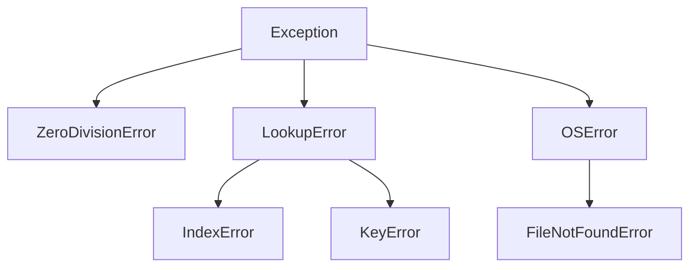
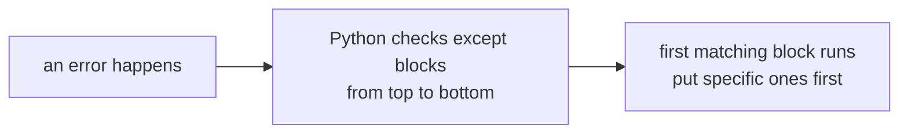
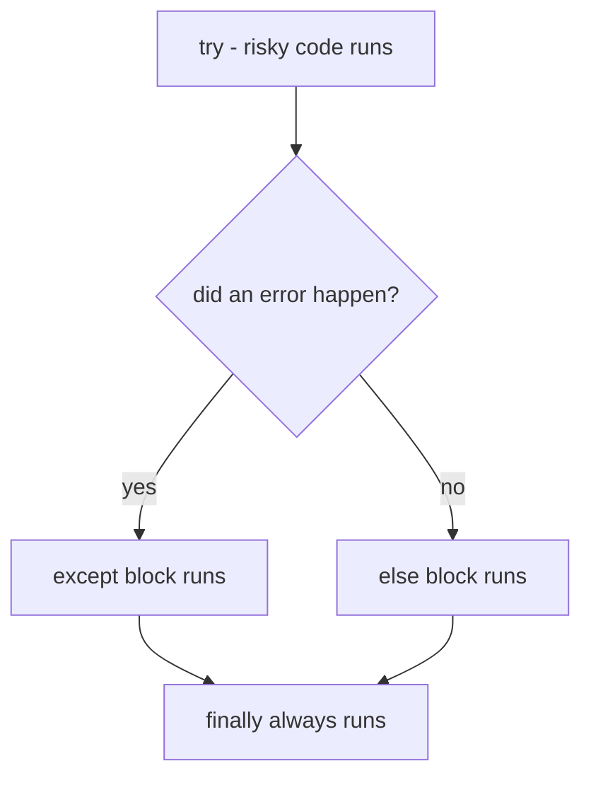
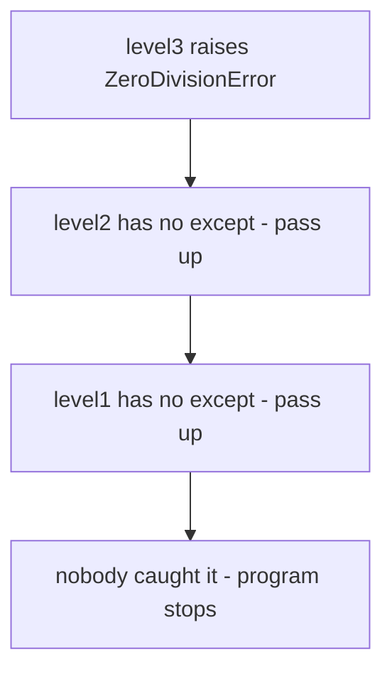

# Exception & Error Handling

> **Exception handling = planning for failure — wrapping risky code in `try/except` so a crash becomes a controlled, handled event instead of a dead program.**

Follows: [MASTER_TEACHING_STYLE.md](../../../AGENT_STYLE/MASTER_TEACHING_STYLE.md) (Rule Sets 1 + 2 + 3 + 4)

## Status
- Status: New / Learning
- Prerequisites: [Classes & Objects](../01-classes-objects.md), [Inheritance](../04-inheritance.md) (exceptions are a class family), [File Handling](../file%20handling/08-file-handling.md)
- Last studied: Day 5
- Confidence: Building

---

## 🗺️ 0. Big Picture

| Question | Simple answer |
|---|---|
| **What is it?** | A system for detecting problems at runtime and responding to them gracefully. |
| **Why does it exist?** | Real programs meet bad input, missing files, and network drops — crashing is not an option. |
| **What problem does it solve?** | One bad record killing a 3-hour training run; cryptic tracebacks shown to users. |
| **Where will you see it?** | Data loading, model APIs, config parsing, retry logic, resource cleanup everywhere. |
| **What do you need first?** | Functions, classes, inheritance (custom exceptions are subclasses). |
| **Bigger picture** | Errors are classified into families; handling = choosing which family to catch and what to do. |

---

## 1. 🎯 Why should you care?

### The GPS analogy 🗺️

```text
No exception handling:
   driving → road blocked → car stops forever   
   (program crashes at the first problem)

With exception handling:
   driving → road blocked → GPS REROUTES → you still arrive ✅
   (error caught, plan B runs, program continues)
```

A `try/except` block is your program's GPS reroute.

### Without handling — one bad row kills everything

```python
numbers = ["10", "20", "abc", "40"]
total = 0
for n in numbers:
    total = total + int(n)     # int("abc") explodes   
print(total)                   # NEVER reached
```

```text
ValueError: invalid literal for int() with base 10: 'abc'
(program dead — lines after never run)
```

### With handling — skip the bad one, keep going

```python
total = 0
for n in numbers:
    try:
        total = total + int(n)
    except ValueError:
        print("skipping bad value:", n)
print(total)                   # 70 ✅
```

ML reality: datasets have missing/corrupt values, files go missing, GPUs run out of memory. Handling is not optional — it's survival.

---

## 2. 🚨 The three types of errors

Every error in Python belongs to one of THREE families:

```text
┌─────────────────────────────────────────────────────┐
│ ① SYNTAX ERROR  — Python can't even READ your code │
│ ② RUNTIME ERROR — code is valid, blows up while    │
│                   running (= EXCEPTIONS)            │
│ ③ LOGICAL ERROR — runs fine, gives WRONG answers   │
└─────────────────────────────────────────────────────┘
```

### Type 1 — Syntax errors ❌ (caught BEFORE running)

```python
if x > 5        # missing colon
    print(x)
```

```text
SyntaxError: expected ':'
```

Python refuses to START. No `try/except` can catch these — the program never begins.

Special cousin:

```python
def f():
print("hi")       # IndentationError — wrong spacing
```

### Type 2 — Runtime errors / Exceptions ⚡ (the main event)

Code is perfectly legal — it explodes WHILE running:

```python
print(10 / 0)          # ZeroDivisionError
int("abc")             # ValueError
"1" + 1                # TypeError
my_list[99]            # IndexError
d["missing_key"]       # KeyError
open("ghost.txt")      # FileNotFoundError
print(nam)             # NameError (typo'd variable)
"hello".push()         # AttributeError
```

These ARE catchable with `try/except`. This topic is mostly about this family.

### Type 3 — Logical errors 😴 (the silent killers)

No crash. No traceback. Just WRONG results:

```python
avg = a + b / 2          # intended (a+b)/2 — math precedence bug!
print(avg)               # prints happily... wrong answer   
```

Python can't catch these — only YOU can, via testing and careful review. ⚠ Hardest bugs to find.

### Side-by-side comparison

| | Syntax error | Runtime error (exception) | Logical error |
|---|---|---|---|
| When detected | before running | while running | never (by Python) |
| Program starts? | no | yes | yes |
| Catchable? | impossible | yes — try/except | only by testing |
| Example | missing colon | `10 / 0` | `a + b / 2` |

---

## 3. 🧬 The exception family tree

All exceptions are CLASSES (topic 04 pays off!). Here's the hierarchy:

```text
BaseException                          (the root   )
 ├── SystemExit                        (sys.exit())
 ├── KeyboardInterrupt                 (you pressed Ctrl+C)
 └── Exception                         ← almost everything lives here
      ├── ArithmeticError
      │    └── ZeroDivisionError
      ├── LookupError
      │    ├── IndexError              (bad list position)
      │    └── KeyError                (bad dict key)
      ├── TypeError                    (wrong type of operation)
      ├── ValueError                   (right type, bad VALUE)
      ├── AttributeError               (missing method/attribute)
      ├── NameError                    (unknown variable name)
      ├── OSError                      (OS-level trouble)
      │    ├── FileNotFoundError
      │    ├── PermissionError
      │    └── IsADirectoryError
      ├── ImportError
      │    └── ModuleNotFoundError
      ├── RuntimeError
      │    └── RecursionError          (function called itself forever)
      ├── StopIteration                (iterator exhausted)
      └── MemoryError                  (RAM exhausted)
```

**📊 Diagram — catching a parent catches its children**



 Why this matters: catching a PARENT catches ALL its children.

```text
catch LookupError  →  catches IndexError AND KeyError
catch Exception    →  catches nearly EVERYTHING
```

Check any error's family yourself:

```python
print(isinstance(FileNotFoundError("x"), OSError))   # True
print(FileNotFoundError.__mro__)
# (... FileNotFoundError → OSError → Exception → BaseException → object)
```

---

## 4. 🛡️ try/except — your safety net

### The anatomy

```python
try:
    risky_code()               # attempt this
except SomeError:
    plan_b()                   # runs ONLY if that error happened
```

### The flow

```text
        enter try
            ↓
    run risky code
            ↓
   ┌── error? ──┐
   NO           YES
   ↓             ↓
skip except    match except type?
   ↓             ↓ NO → program dies with traceback   
continue       YES ↓
             run plan_b
                ↓
          continue together ✅
```

### First example

```python
try:
    x = int(input("enter a number: "))
    print("100 /", x, "=", 100 / x)
except ZeroDivisionError:
    print("cannot divide by zero!")
except ValueError:
    print("that was not a number!")

# input "0"    → cannot divide by zero!
# input "abc"  → that was not a number!
# input "5"    → 100 / 5 = 20.0
```

Walk through it (input `"0"`):

```text
try block starts
   ↓
int("0") fine → 100 / 0 → BOOM ZeroDivisionError   
   ↓
Python jumps OUT of try mid-line
   ↓
searches except clauses top-down → ZeroDivisionError matches ✅
   ↓
prints message → program continues normally
```

---

## 5. 📖 Catching like a pro

### 5.1 One handler for many errors — tuple

```python
try:
    do_something()
except (TypeError, ValueError) as e:
    print("bad input:", e)
```

### 5.2 The exception OBJECT — read the details

`as e` captures the error object itself:

```python
try:
    int("abc")
except ValueError as e:
    print(type(e).__name__)   # ValueError
    print(e)                  # invalid literal for int() with base 10: 'abc'
    print(e.args)             # ("invalid literal for int() with base 10: 'abc'",)
```

### 5.3 The most common errors — quick reference table

| Error | Triggered by | Example |
|---|---|---|
| `ZeroDivisionError` | dividing by zero | `10 / 0` |
| `ValueError` | right type, bad value | `int("abc")` |
| `TypeError` | wrong type entirely | `"1" + 1` |
| `IndexError` | list position out of range | `[1, 2][5]` |
| `KeyError` | dict key doesn't exist | `d["nope"]` |
| `NameError` | using an unknown name | `print(nam)` |
| `AttributeError` | attribute/method missing | `"s".push()` |
| `FileNotFoundError` | opening a missing file | `open("ghost.txt")` |
| `ModuleNotFoundError` | bad import name | `import pandass` |
| `RecursionError` | infinite recursion | function calls itself forever |
| `KeyboardInterrupt` | user presses Ctrl+C | manual stop |
| `StopIteration` | calling `next()` past the end | exhausted iterator |

⚠ Value vs Type confusion — memorize this:

```text
TypeError  → WRONG TYPE involved        ("1" + 1)
ValueError → RIGHT type, BAD content    (int("abc"))
```

### 5.4 Order matters! Subclasses before parents ⚠️

```python
try:
    open("ghost.txt")
except Exception:              # ❌ catches EVERYTHING first...
    print("some problem")
except FileNotFoundError:      # ...so this is UNREACHABLE dead code
    print("file missing")
```

✅ Correct: most specific FIRST, broadest LAST:

```python
try:
    open("ghost.txt")
except FileNotFoundError:      # specific first ✅
    print("file missing")
except Exception as e:         # general last (final safety net)
    print("unexpected:", e)
```

**📊 Diagram — specific except first, broad except last**



### 5.5 The bare `except:` — a trap ⚠️

```python
try:
    process()
except:                        # catches EVERYTHING incl. Ctrl+C & sys.exit!
    pass                       # silent swallow — bugs vanish without a trace   
```

Bare except catches `BaseException` — even your Ctrl+C gets ignored. Always catch `Exception` (or something more specific) instead.

---

## 6. ➕ else and finally — the full anatomy

All four blocks together:

```python
try:
    f = open("data.txt")       # ① risky zone
except FileNotFoundError:
    print("no such file")      # ② runs ONLY on that error
else:
    print("read ok:", len(f.read()))   # ③ runs ONLY if NO error
finally:
    print("always done")       # ④ runs ALWAYS — error or not
```

**📊 Diagram — try, except, else, finally at a glance**



### The truth table

```text
scenario            except   else    finally
─────────────────────────────────────────────
no error              skip    runs    runs
handled error         runs    skip    runs
unhandled error       skip    skip    runs → then program dies
```

### Why `finally` exists — cleanup that ALWAYS happens

```python
try:
    f = open("data.txt")
    result = heavy_processing(f)
finally:
    f.close()                  # runs even if heavy_processing crashed!
    print("file closed")
```

 You already know the modern alternative from file handling: `with open(...)` does exactly this via `__exit__`. `finally` is the manual version — use it for cleanups that don't have a context manager.

### Where `else` shines

Keeping `try` SMALL — only the risky line inside:

```python
try:
    x = int(user_input)        # only THIS can fail
except ValueError:
    print("not a number")
else:
    print("got:", x)           # safe code stays out of the net
```

---

## 7. 📣 raise — throwing errors YOURSELF

Don't wait for Python to notice — reject bad data loudly:

```python
def set_age(age):
    if age < 0:
        raise ValueError("age cannot be negative")
    print("age set to", age)

set_age(-5)
```

```text
Traceback (most recent call last):
  ...
ValueError: age cannot be negative
```

### Flow of raise

```text
raise ValueError("msg")
        ↓
an exception OBJECT is created
        ↓
it travels UP the call stack looking for a matching except
        ↓
found? → handled there ✅      none? → program dies   
```

### Re-raising — handle AND pass it on

```python
try:
    save_important_data()
except Exception as e:
    log("something failed:", e)
    raise                       # ← bare raise re-throws the SAME error
```

Log it locally, then let the caller decide too. Best of both worlds.

### `raise` from validation — connect to encapsulation (topic 03!)

Your property setters already used this idea: rejecting `-50` balance with a guard. `raise` is how guards shout.

---

## 8. 🏗️ Custom exceptions — build your own error family

Since exceptions are classes, you can create your own branch of the tree:

```python
class DataError(Exception):            # parent for all MY data problems
    pass

class EmptyDatasetError(DataError):
    pass

class BadLabelError(DataError):
    pass


def load(path):
    rows = read_rows(path)
    if len(rows) == 0:
        raise EmptyDatasetError(f"{path} has zero rows")


def check(labels):
    for y in labels:
        if y not in (0, 1):
            raise BadLabelError(f"label {y} is neither 0 nor 1")
```

### Why bother?

```text
① readable  → "EmptyDatasetError" says EXACTLY what went wrong
② catchable as a family → except DataError catches both, misses nothing
③ can carry data → add attributes, custom messages, hints
```

```python
try:
    load("train.csv")
    check(labels)
except DataError as e:                     # catches BOTH custom types ✅
    print("data problem:", e)
```

Convention: name ends with `Error`, inherit from `Exception` (directly or via a project base class).

### At three levels

```text
Level 1 (Simple):    wrap risky lines in try/except to keep the program alive.
Level 2 (Precise):   exceptions are classes in a hierarchy; handlers match
                     top-down; else = success-only path; finally = always-run
                     cleanup; raise creates and throws error objects.
Level 3 (Advanced):  custom exception trees encode domain failures; bare
                     except traps BaseException; re-raise supports layered
                     logging; EAFP treats errors as normal control flow.
```

---

## 9. 🔍 How exceptions travel — the call stack

An unhandled exception doesn't die where it was born — it CLIMBS:

```python
def level3():
    return 10 / 0                    #    born here

def level2():
    level3()                         # passes the panic upward

def level1():
    level2()                         # ...and upward

level1()
```

```text
level3 raises ZeroDivisionError
      ↑ climbs
level2 has no handler → pass up
      ↑ climbs
level1 has no handler → pass up
      ↑ climbs
main scope: no handler → PROGRAM DIES    + traceback printed
```

**📊 Diagram — an uncaught error climbs until someone stops it**



### Any level can catch it

```python
def level2():
    try:
        level3()
    except ZeroDivisionError:
        print("caught in level2!")   # panic stops HERE ✅
```

### Reading a traceback (bottom-up!)

```text
Traceback (most recent call last):     ← read from BOTTOM
  File "main.py", line 12, in <module>
    level1()
  File "main.py", line 8, in level1
    level2()
  File "main.py", line 4, in level2
    level3()
  File "main.py", line 2, in level3
    return 10 / 0
ZeroDivisionError: division by zero    ← error type + message live HERE
```

```text
reading recipe:
① bottom line  → WHAT went wrong
② above it     → WHERE (exact file/line)
③ middle frames → the path the call took
```

---

## 10. 🧠 EAFP vs LBYL — two life philosophies

```text
LBYL — "Look Before You Leap"   
   check conditions FIRST, then act

EAFP — "Easier to Ask Forgiveness than Permission"   
   just DO it, catch the failure if it comes
```

```python
# LBYL — check first
if "lr" in config:
    lr = config["lr"]
else:
    lr = 0.001

# EAFP — pythonic way ✅
try:
    lr = config["lr"]
except KeyError:
    lr = 0.001
```

Or even shorter with `dict.get` — but for non-dict cases, EAFP wins because:

```text
① no race conditions (state can change between check and act)
② often faster (one operation instead of check + operation)
③ idiomatic — Python culture prefers it
```

Related tool — `assert`: a debug-time guard that raises `AssertionError` when a condition is false:

```python
assert hasattr(model, "fit"), "model must implement fit()"
```

⚠ Asserts can be stripped with `-O` flag — never use them for real validation in production; use `raise`.

---

## 11. ⚠️ Common mistakes

| Mistake | Why it hurts |
|---|---|
| Bare `except:` | swallows Ctrl+C and sys.exit; hides real bugs silently |
| `except Exception` written FIRST | makes later specific handlers unreachable dead code |
| Putting huge blocks inside `try` | you catch errors you never intended and mask real bugs |
| Ignoring the exception (`pass`) | failure disappears without a trace — worst debugging nightmare |
| Catching without logging/re-raising | callers never learn anything failed |
| Using exceptions for normal control flow everywhere | hard-to-read spaghetti; exceptions are for exceptional paths |
| Trying to catch `SyntaxError` | impossible — program never starts |
| Forgetting logical errors exist | no crash ≠ correct; test your outputs |
| `assert` for production validation | stripped under `python -O`; use `raise ValueError(...)` |

---

## 12. 🤖 ML connection

```python
# ① bulletproof data loading
def load_features(path):
    try:
        return pd.read_csv(path)
    except FileNotFoundError:
        print("missing dataset:", path)
        return None

# ② training loop that survives one bad batch
for X, y in loader:
    try:
        loss = train_step(X, y)
    except ValueError as e:
        print("skipping bad batch:", e)
        continue

# ③ memory-aware fallback
try:
    model.fit(X_big)
except MemoryError:
    model.fit(X_sample)          # degrade gracefully

# ④ fail-fast configuration checks
def require(cond, msg):
    if not cond:
        raise ConfigError(msg)   # custom exception family
```

Real frameworks live by this: PyTorch DataLoader workers catch and re-raise worker crashes; sklearn validates hyperparameters by raising `ValueError` early — fail fast, fail clear.

---

## 13. 🎯 PREDICT drills

Say your answer OUT LOUD first!

### Drill 1

```python
try:
    x = int("42")
except ValueError:
    print("bad")
else:
    print("good")
finally:
    print("done")
```

**Answer:** `good` then `done` — no error → except skipped, else runs, finally always runs.

### Drill 2 — trap

```python
try:
    print("a")
    print(1 / 0)
    print("b")
except ZeroDivisionError:
    print("c")
```

**Answer:** `a` then `c` — execution jumps out of try at the failing line, so `"b"` NEVER prints.

### Drill 3 — order trap

```python
try:
    [1, 2][5]
except Exception:
    print("general")
except IndexError:
    print("specific")
```

**Answer:** `general` — `Exception` matched first (it's the parent!), so the `IndexError` handler is unreachable. Specific handlers must come first.

### Drill 4 — finally always wins

```python
def f():
    try:
        return "from try"
    finally:
        print("cleanup")

print(f())
```

**Answer:** `cleanup` then `from try` — finally runs EVEN WHEN try returns! Cleanup is guaranteed.

### Drill 5 — the bare except trap

```python
while True:
    try:
        job()
    except:
        pass
```

You press Ctrl+C to stop this program. What happens?

**Answer:** NOTHING — it keeps running! Bare `except:` catches `KeyboardInterrupt` too and swallows it. Use `except Exception:` minimum, better: specific errors.

### Drill 6 — custom family

```python
class AppError(Exception): pass
class DBError(AppError): pass

try:
    raise DBError("connection lost")
except AppError as e:
    print("app problem:", e)
```

**Answer:** `app problem: connection lost` — `DBError` IS-A `AppError`, so the parent handler catches it (inheritance!).

---

## 14. 🧪 Experiment

1. Write `safe_div(a, b)` returning `None` on `ZeroDivisionError` — then upgrade it to ASK the user again until input is valid.
2. Build a custom family: `ModelError(Exception)` → `NotFittedError`, `BadShapeError`. Raise them from fake `predict()` and catch both via the parent.
3. Take your file-handling logger and wrap it so a missing folder is created (`os.makedirs`) instead of crashing.
4. Force a `RecursionError` (function calling itself with no base case) — read the traceback bottom-up.
5. Compare timing: LBYL (`if key in d`) vs EAFP (`try: d[key]`) on a big dict in a loop — see why Python prefers EAFP.

---

## 15. 🎤 Interview questions

**Q: Difference between an error and an exception?**
Simple: syntax errors stop the program before it starts; exceptions happen during running and can be caught.
Stronger: Python distinguishes `SyntaxError` (compile-time, uncatchable at runtime) from runtime exceptions — classes descending from `BaseException`. `SystemExit` and `KeyboardInterrupt` sit outside `Exception` deliberately so broad handlers don't swallow them.

**Q: What is the exception hierarchy?**
All exceptions derive from `BaseException`; user-facing ones derive from `Exception`. Important branches: `ArithmeticError` (→ `ZeroDivisionError`), `LookupError` (→ `IndexError`, `KeyError`), `OSError` (→ `FileNotFoundError`, `PermissionError`). Catching a parent catches all children — hence specificity ordering matters.

**Q: When do `else` and `finally` run?**
Simple: else = only when NO error; finally = always.
Stronger: `else` runs when the try block completes without exception (keeping the try minimal); `finally` runs on success, handled failure, AND unhandled failure — even before a `return` takes effect — making it the guaranteed-cleanup hook (or prefer a context manager).

**Q: Why avoid bare `except:`?**
It binds to `BaseException`, catching `KeyboardInterrupt`/`SystemExit` — unclosable programs, silently swallowed bugs. Catch `Exception` or, better, the narrowest type that you can actually handle.

**Q: Why write custom exceptions?**
They turn domain failures into a named, catchable family (`except DataError`), make tracebacks self-explanatory, and let callers distinguish YOUR failures from accidental bugs. Convention: inherit from `Exception`, name ends in `Error`.

**Q: What is EAFP?**
"Easier to Ask Forgiveness than Permission" — attempt the operation and handle the exception rather than pre-checking conditions. It's Pythonic, avoids check-then-act race conditions, and is typically faster.

---

## 16. 📄 Cheat sheet

```text
EXCEPTION HANDLING
═══════════════════════════════════════
THREE ERROR TYPES
→ syntax    : can't start at all (uncatchable)
→ runtime   : exceptions — catchable (this topic!)
→ logical   : silent wrong answers — only testing finds them

FULL ANATOMY
→ try:      risky line(s) ONLY
→ except T: runs on matching error (specific FIRST, broad LAST)
→ else:     runs only if NO error
→ finally:  runs ALWAYS (cleanup)

HIERARCHY (catch parent = catch children)
→ BaseException → Exception → (TypeError, ValueError,
→ LookupError → IndexError/KeyError, OSError → FileNotFoundError...)

RAISING
→ raise ValueError("msg")        throw
→ raise                          re-throw same error
→ class MyError(Exception): ...  custom family

GOLDEN RULES
→ never bare except:  (traps Ctrl+C!)
→ never swallow silently (log it or re-raise)
→ keep try blocks small
→ EAFP: try it, catch it — the Pythonic way

TRACEBACK READING
→ bottom line = WHAT · above it = WHERE · middle = call path
```

---

## ⭐ Key Takeaway

> **Errors come in three families — syntax (never starts), runtime exceptions (catchable), logical (silent) — and `try/except/else/finally` turns the catchable ones from program-killers into planned detours.**

---

## ✅ Progress

```text
WHAT YOU NOW KNOW:        3 error types, the exception family tree,
                          try/except/else/finally, raise + custom
                          exceptions, propagation & tracebacks, EAFP
WHAT YOU SHOULD REMEMBER: specific handlers before broad ones;
                          finally always runs; never bare except;
                          catch parents to catch whole families
WHAT WE LEARN NEXT:       applying modules & packages to organize
                          growing projects
```
