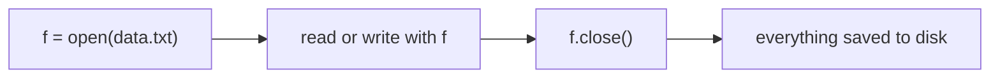
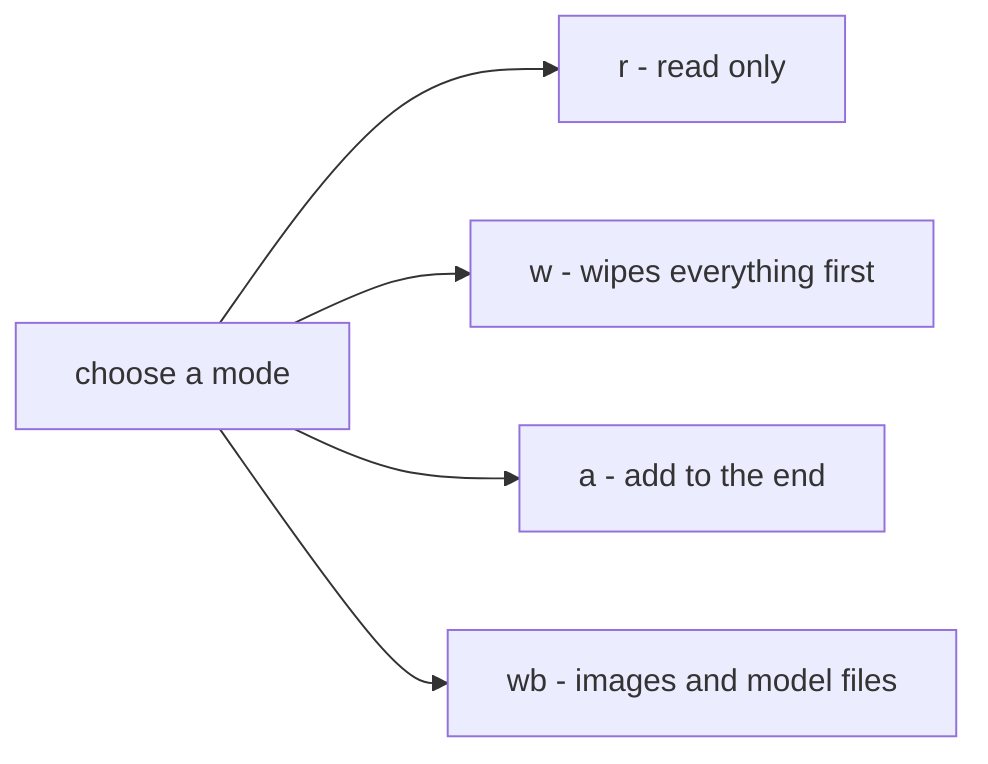
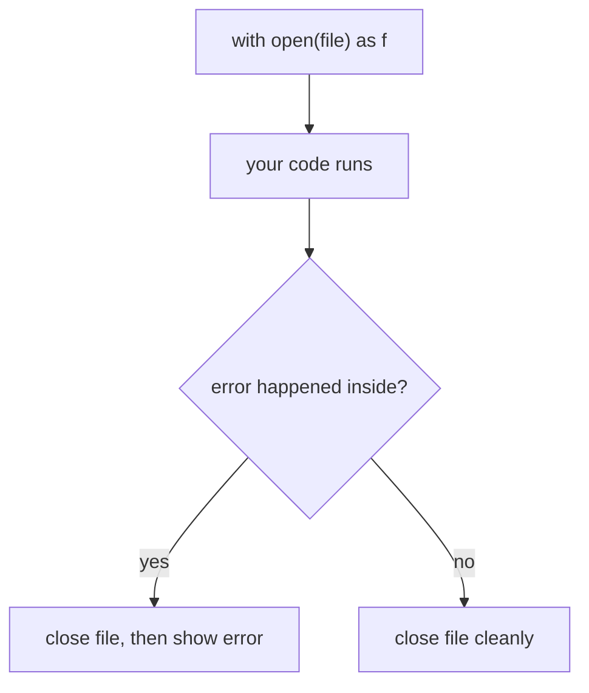

# File Handling

> **File handling = talking to files on your disk — reading data IN, writing data OUT, and never leaking resources, using `open()` + `with`.**

Follows: [MASTER_TEACHING_STYLE.md](../../../AGENT_STYLE/MASTER_TEACHING_STYLE.md) (Rule Sets 1 + 2 + 3)

## Status
- Status: New / Learning
- Prerequisites: [Classes & Objects](../01-classes-objects.md), strings, lists, [Magic Methods](../07-magic-methods.md) (`with` uses dunders!)
- Last studied: Day 5
- Confidence: Building

---

## 🗺️ 0. Big Picture

| Question | Simple answer |
|---|---|
| **What is it?** | Reading from and writing to files on disk from your code. |
| **Why does it exist?** | Variables DIE when the program ends — files live FOREVER. |
| **What problem does it solve?** | Saving results, loading datasets, keeping logs, storing checkpoints. |
| **Where will you see it?** | Loading CSVs, saving models, reading configs, writing training logs. |
| **What do you need first?** | Strings, lists, loops, `with` readiness (topic 07 dunders). |
| **Bigger picture** | RAM = short-term memory · Disk = long-term memory. Files are the bridge. |

---

## 1. 🎯 Why should you care?

### The brain vs notebook analogy 🧠📓

```text
RAM (variables)                  DISK (files)
─────────────────────           ────────────────────
super fast                       slower
forgets EVERYTHING               remembers FOREVER
when program ends                even after shutdown
```

Your variables are thoughts in your head — powerful but gone when you sleep (program ends).
Files are your notebook — slower to write, but there tomorrow.

```text
train model → results in RAM → program ends → GONE
train model → results saved to FILE → program ends → still there ✅
```

ML is FULL of this:

- load a dataset (CSV) → **read**
- save trained model weights → **write**
- log epoch losses → **append**
- read hyperparameters from config → **read**

---

## 2. 🧠 The mental model

A file object is a **remote control** between your program and the disk:

```text
your code                file object            actual file on disk
─────────                ───────────            ───────────────────
f.read()   ──────────►     ─────────────────►     reads bytes
f.write(x) ──────────►     ─────────────────►     writes bytes
f.close()  ──────────►     ───────  ────────►     connection cut

open("data.txt")      builds the remote control
f.close()             cuts the connection (ALWAYS do this!)
```

Three-step ritual — every single time:

```text
① OPEN   →  f = open("data.txt", "r")   # get the remote
② USE    →  text = f.read()             # press buttons
③ CLOSE  →  f.close()                   # hang up
```

**📊 Diagram — open, use, close**



---

## 3. 📖 Core concept — step by step

### 3.1 `open()` — the gateway 🚪

```python
f = open("data.txt", "r")     # open data.txt for READING
```

Two key ingredients: the **filename** and the **mode** (what you plan to do).

### The modes menu 🍽️

| Mode | Name | What it does | If file missing? |
|---|---|---|---|
| `"r"` | read | read only | ❌ `FileNotFoundError` |
| `"w"` | write | write (WIPES existing content!) | creates it |
| `"a"` | append | add to the END | creates it |
| `"x"` | exclusive | create ONLY if new | exists? ❌ `FileExistsError` |
| `"r+"` | read+write | both, file must exist | ❌ error |

⚠ **THE #1 DANGER:** `"w"` does NOT mean "write nicely". It means **DESTROY FIRST**:

```text
data.txt contains: "10 years of notes   "
        ↓
open("data.txt", "w")
        ↓
data.txt now contains: ""   ← WIPED INSTANTLY!
```

**📊 Diagram — picking a file mode**



The wipe happens at OPEN time — even before you write anything!

Binary versions for non-text data (images, model weights): `"rb"`, `"wb"`.

### 3.2 Reading 👀 — four ways

Say `data.txt` contains:

```text
hello
ml world
```

**Way 1 — `read()`: everything as ONE string**

```python
f = open("data.txt")
text = f.read()
print(text)          # hello\nml world
print(f.read())      # "" ← empty! pointer is at the END
```

**Way 2 — `readline()`: ONE line at a time**

```python
f = open("data.txt")
print(f.readline())  # "hello\n"     ← includes the \n!
print(f.readline())  # "ml world"
```

**Way 3 — `readlines()`: ALL lines as a LIST**

```python
f = open("data.txt")
lines = f.readlines()
print(lines)         # ["hello\n", "ml world\n"]
```

**Way 4 — loop directly ⭐ (the BEST way)**

```python
with open("data.txt") as f:      # with = auto-close (section 3.4!)
    for line in f:
        print(line.strip())      # strip() removes the trailing \n
```

```text
memory-friendly ranking   :
loop over file  >  readline()  >  readlines()  >  read()
(line by line)     (one line)     (all in RAM)    (ALL in RAM   )
```

A 10 GB dataset with `read()` = 10 GB swallowed into RAM. Line-by-loop = tiny memory. Huge deal in ML!

### 3.3 Writing ✍️

```python
f = open("out.txt", "w")       # ⚠ wipes out.txt if it exists!
f.write("epoch 1: loss=0.5")   # write() does NOT add \n
f.write("epoch 2: loss=0.3")   # ...so these glue together!
f.close()
```

Result inside `out.txt`:

```text
epoch 1: loss=0.5epoch 2: loss=0.3     ← glued!
```

✅ Fix: add `\n` yourself:

```python
f.write("epoch 1: loss=0.5\n")
f.write("epoch 2: loss=0.3\n")
```

```text
epoch 1: loss=0.5
epoch 2: loss=0.3          ✅
```

Append mode for logs (add WITHOUT destroying):

```python
f = open("log.txt", "a")       #    end of file, safe
f.write("epoch 3: loss=0.2\n")
f.close()
```

```text
"w"     →     wipe → write from scratch
"a"     →  keep everything → add at the END
```

### 3.4 `with` — the auto-close superpower ⭐

The problem with manual close:

```python
f = open("data.txt")
text = f.read()
crash_here()          #    exception! f.close() NEVER runs
f.close()             # skipped — file left hanging open
```

The fix — `with`:

```python
with open("data.txt") as f:
    text = f.read()
# ← leaving this block AUTOMATICALLY closes f
# even if an error happened inside! 🛡️
```

```text
with open(...) as f:
        ↓
opens file → gives you f
        ↓
your code runs
        ↓
block ends (normal OR crash)
        ↓
close() GUARANTEED
```

**📊 Diagram — with closes the file even on errors**



This works because file objects have `__enter__` and `__exit__` dunder methods — the context-manager protocol from topic 07!

Interview gold: *"Always use `with` — it closes the file even if an exception occurs."*

---

## 4. 🔍 Inside the file object (internals)

### 4.1 The pointer 📍

Every open file has a POSITION POINTER — where the next read/write happens:

```python
f = open("data.txt")
print(f.tell())      # 0   ← pointer at start
f.read(5)            # reads 5 characters
print(f.tell())      # 5   ← pointer moved!
```

```text
 h  e  l  l  o  \n  m  l ...
  (0) → after read(5) →   (5)
```

Move it with `seek()`:

```python
f.seek(0)            # back to the START
print(f.read())      # full content again!
```

This explains Drill 4 later: a second `read()` returns `""` — the pointer is already at the end!

### 4.2 Buffering — the waiting room 🪑

Writes don't go straight to disk. They sit in a BUFFER (small waiting room in RAM):

```text
f.write("abc")
      ↓
   buffer (fast RAM)
      ↓ (flushed when: buffer full / close() / flush())
   actual disk file
```

Why? Disk writes are SLOW. Batching them = speed.

⚠ The danger: program crashes BEFORE flush → buffered data vanishes!

```python
f.write("important data")    # sitting in buffer
crash!                        #    never reached disk
```

✅ Fix: `with` (closes→flushes) or call `f.flush()` for critical writes.

### 4.3 Encoding — how letters become bytes 🔤🔢

Disk stores BYTES (numbers), not letters. Encoding = the translation table:

```text
"h"  --utf-8-->  104        (writing: encode)
104 --utf-8-->  "h"         (reading: decode)
```

Mismatch the tables → garbage or crashes:

```python
# ✅ ALWAYS name the encoding explicitly:
with open("data.txt", "r", encoding="utf-8") as f:
    ...
```

⚠ Windows defaults may differ (cp1252) — emoji/Unicode can explode. Naming `encoding="utf-8"` makes it work EVERYWHERE.

### 4.4 Text mode vs binary mode

```text
TEXT mode "r"/"w"             BINARY mode "rb"/"wb"
→ str in, str out             → bytes in, bytes out
→ handles encoding for you    → raw bytes, no translation
→ \n handled per-OS           → exact bytes, always
→ for: txt, csv, json         → for: images, .pt model files, zip
```

### At three levels 🪜

```text
Level 1 (Simple):    open → read/write → close. Use with! ⭐
Level 2 (Precise):   file object wraps a OS file handle; a pointer tracks
                     position; writes buffer before hitting disk; text mode
                     encodes/decodes via the given encoding.
Level 3 (Advanced):  open() talks to the OS which returns a file descriptor;
                     Python layers buffering + text decoding over it;
                     with works via the context-manager protocol
                     (__enter__/__exit__) — deterministic resource cleanup.
```

---

## 5. ⚠️ Common mistakes

| Mistake ❌ | What happens |
|---|---|
| Using `"w"` to "just add a line" | ENTIRE file wiped instantly — use `"a"`! |
| Forgetting `f.close()` | data stuck in buffer, file locked, resource leak |
| Reading AFTER close | `ValueError: I/O operation on closed file` |
| Expecting `write()` to add newlines | everything glues into one line — add `\n` yourself |
| Second `f.read()` returning `""` | not broken! pointer is at the end — `seek(0)` first |
| No `encoding="utf-8"` | works on your machine breaks elsewhere |
| `read()` on a huge file | swallows gigabytes into RAM — loop instead |

---

## 6. 🤖 ML connection

```python
# the daily bread of ML 🍞
import json, csv

# ① read a config ⚙️
with open("config.json") as f:
    cfg = json.load(f)                 # {"lr": 0.001, "epochs": 100}

# ② log training progress 📜
with open("train_log.csv", "a", encoding="utf-8") as f:
    f.write(f"{epoch},{loss:.4f}\n")   # append each epoch

# ③ save/load anything (PyTorch does binary mode under the hood) 💾
# torch.save(model.state_dict(), "model.pt")   → binary write "wb" style
# np.savetxt("preds.csv", preds, delimiter=",") → text writing for you
```

```text
real ML pipeline flow:
CSV/JSON on disk    → load → train    → log to file    → save weights
```

pandas' `pd.read_csv(...)`? A fancy wrapper around exactly these ideas.

---

## 7. 🎯 PREDICT drills

Say your answer OUT LOUD first!

### Drill 1

```python
f = open("notes.txt", "w")     # notes.txt had 500 lines
f.close()
```

What does `notes.txt` contain now?

**Answer:** NOTHING — empty file. `"w"` wiped it at OPEN time, before any write.

### Drill 2 — trap ⚠️

```python
f = open("data.txt")
f.close()
f.read()
```

**Answer:** `ValueError: I/O operation on closed file` ❌ — the remote control is disconnected.

### Drill 3

```python
with open("out.txt", "w") as f:
    f.write("hello")
    f.write("world")
```

What's in `out.txt`?

**Answer:** `helloworld` — glued! `write()` never adds `\n`. ✅ Fix: `f.write("hello\n")`.

### Drill 4 — trickier

```python
with open("data.txt") as f:      # data.txt: "abc"
    print(f.read())
    print(f.read())
```

**Answer:** `abc` then an EMPTY line. First read consumes everything → pointer at end → second read gets `""`. Not a bug — mechanics! (`seek(0)` would rewind.)

### Drill 5 — the mode test

```python
with open("log.txt", "w") as f:     # step 1
    f.write("line 1\n")

with open("log.txt", "a") as f:     # step 2
    f.write("line 2\n")

with open("log.txt", "w") as f:     # step 3
    f.write("line 3\n")
```

What's finally in `log.txt`?

**Answer:** only `line 3` ✅

```text
step 1: "w" → create "line 1"
step 2: "a" → append → "line 1\nline 2"
step 3: "w" → WIPE ALL → "line 3"
```

---

## 8. 🧪 Experiment

1. Write a list of 5 losses to `losses.txt`, one per line. Read it back with a `for` loop.
2. Open a file WITHOUT `with`, raise an error mid-way, then check: did the last write survive? Add `flush()` and compare.
3. Build a mini logger: every run APPENDS a timestamp line to `run.log` — run it 3 times, view the history.
4. Save a dict as JSON (`json.dump`), read it back (`json.load`) — round trip!
5. Try opening a missing file with `"r"` — meet `FileNotFoundError` face to face. Then try `"a"` — see it get created.

---

## 9. 🎤 Interview questions

**Q: Difference between `"w"` and `"a"` modes?**
Simple: `w` starts fresh (wipes!), `a` adds to the end.
Stronger: `w` truncates to zero length at open time and creates if missing; `a` keeps contents and atomically positions writes at EOF, creating if missing. Logs use `a`; reports regenerated from scratch use `w`.

**Q: Why prefer `with open(...)` over manual close?**
Simple: it closes automatically — even during errors.
Stronger: `with` binds the file object via the context-manager protocol (`__enter__`/`__exit__`); `__exit__` runs on normal exit AND exceptions, guaranteeing close → buffers flush → no leaked descriptors.

**Q: `read()` vs `readline()` vs `readlines()`?**
Simple: everything / one line / list of all lines.
Stronger: `read()` loads the entire file into one string (RAM-heavy); `readline()` streams one line per call; `readlines()` builds a full list. For big files, iterate the file object directly — lazy, line-by-line, constant memory.

**Q: What happens internally when you open a file?**
Simple: Python asks the OS for a handle to the file.
Stronger: `open()` requests a file descriptor from the OS, then wraps it: binary buffered layer first, text encoding/decoding layer on top for text mode. Reads pull through the buffer; writes queue in it until flush/close.

**Q: Why specify `encoding="utf-8"`?**
Text mode must decode bytes → str. The default varies by platform (Windows ≠ Linux), so the same file can parse differently across machines. Pinning utf-8 makes behavior identical everywhere.

---

## 10. 📄 Cheat sheet

```text
FILE HANDLING
═══════════════════════════════════════
THE RITUAL ⭐
→ with open(path, mode, encoding="utf-8") as f:
→     use f
→ (auto-closed, even on errors   )

MODES
→ "r"    read      (missing → FileNotFoundError)
→ "w"    write     (WIPES FIRST! ⚠ creates if missing)
→ "a"    append    (adds at END, creates if missing)
→ "x"    new only  (exists → FileExistsError)
→ "rb"/"wb"        binary (images, model weights)

READING
→ f.read()        everything (RAM heavy   )
→ f.readline()    one line
→ for line in f:  ⭐ best — line by line

WRITING
→ f.write(s)      NO auto-newline — add "\n" yourself!
→ f.flush()       force buffer → disk now

POINTER
→ f.tell()        where am I?
→ f.seek(0)       back to start

GOLDEN RULES
→ "w" destroys ⚠ · logs use "a" · always with ⭐
→ always encoding="utf-8" · big files: loop, don't read()
```

---

## ⭐ Key Takeaway

> **Variables die when the program ends; files live forever — so master the ritual: `with open(...) as f:` + right mode + explicit `encoding="utf-8"`, and remember `"w"` wipes!**

---

## ✅ Progress

```text
WHAT YOU NOW KNOW:        open modes, 4 ways to read, writing/appending,
                          with-statement safety, pointers, buffering,
                          encoding, text vs binary
WHAT YOU SHOULD REMEMBER: "w" wipes at open time ⚠; with = guaranteed
                          close   ; write() needs manual \n; loop big
                          files instead of read()
WHAT WE LEARN NEXT:       applying files to real datasets with
                          pandas / numpy workflows
```
