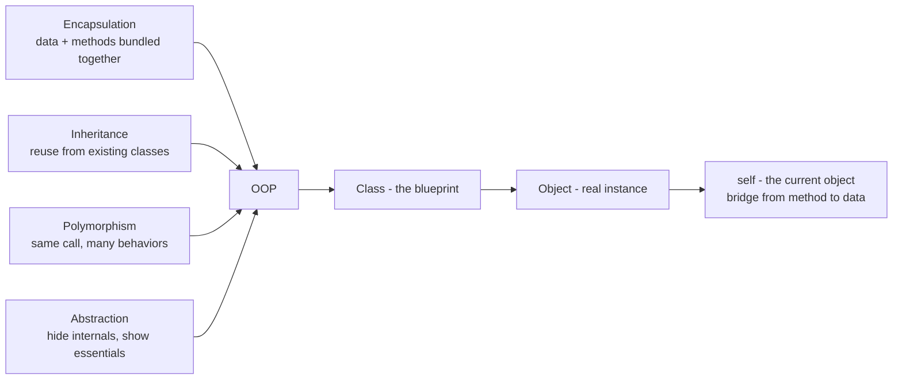

# Object-Oriented Programming (OOP) & `self` in Python

**📊 Diagram — The four pillars of OOP and how class, object and self connect**



## 1. The Golden Rule of OOP

> **Everything in Python is an object.**

And the golden rule of OOP is:

> **Only an object can access the members of its class.**

Class members = **attributes** (data) + **methods** (functions).

## 2. What is a Class?

A class is a **blueprint** — a design or template. By itself it is just a description.
You cannot touch its members directly because there is no object yet.

```python
class Car:
    def __init__(self, color):
        self.color = color          # attribute (data)

    def drive(self):                # method (function)
        print(f"A {self.color} car is driving")
```

## 3. What is an Object?

An object is a **real thing created from the blueprint**.
Only after you create an object can you actually use the class members.

```python
my_car = Car("red")   # my_car is now an object (an instance of Car)
my_car.drive()        # ✅ object is calling the method
```

## 4. Where does `self` come in?

Now the problem: **inside the class there is no object yet** — it is just a blueprint.
So how do the methods reach the class members?

The answer is `self`.

> **`self` is the current object — the object you are working with right now.**

When you call a method on an object, Python **automatically passes that object**
as the first argument to the method. We name that argument `self` by convention.

```python
my_car.drive()
# is secretly turned into:
Car.drive(my_car)
# so inside drive(),  self = my_car
```

So `self` is the **bridge** that lets a method talk to the data of the current object.

## 5. Full example — step by step

```python
class Student:
    def __init__(self, name, age):
        self.name = name            # self = the object being created
        self.age = age

    def info(self):
        return f"{self.name} is {self.age} years old"
```

```python
s1 = Student("Alice", 20)   # Python calls: Student.__init__(s1, "Alice", 20)
s2 = Student("Bob", 22)     # Python calls: Student.__init__(s2, "Bob", 22)

print(s1.info())            # Alice is 20 years old   → self = s1
print(s2.info())            # Bob is 22 years old     → self = s2
```

Same method `info`, but it behaves differently — because `self` changes to the object that called it.

## 6. With vs without `self`

```python
class Student:
    def __init__(self, name):
        self.name = name

    def wrong(self):
        return name          # ❌ NameError — which object's name? Python doesn't know

    def right(self):
        return self.name     # ✅ Works — self points to the current object
```

## 7. Key points to remember

1. `self` = the current object.
2. `self` is passed automatically — you never pass it yourself.
3. Without `self`, methods have no way to access the object's data.
4. It must be the **first parameter** of every instance method.

## 8. One-liner summary

> `self` is the current object, automatically passed to class methods, so they can access the class members — because only an object can access them.
