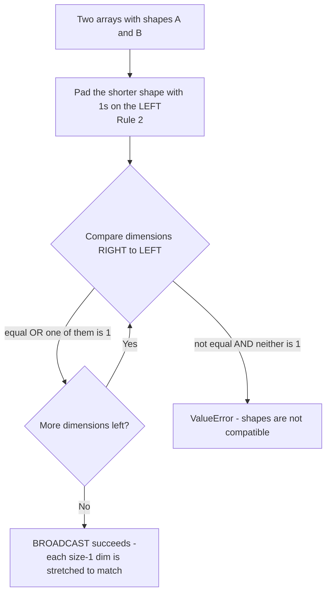
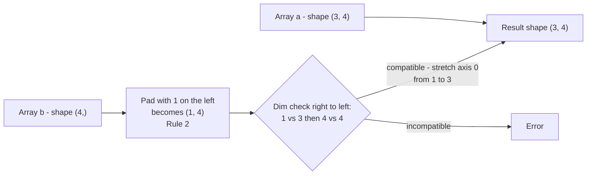
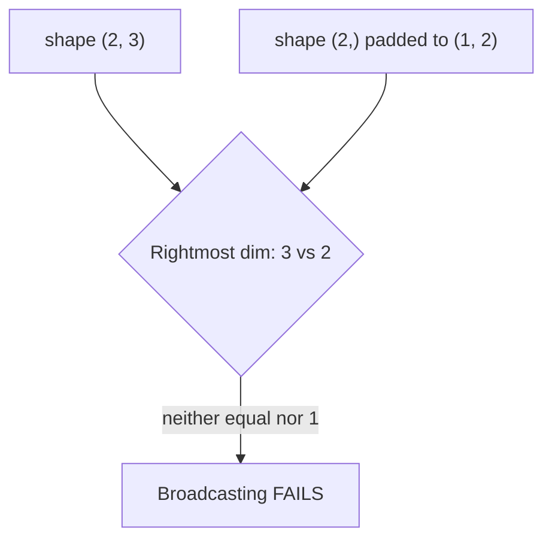

# NumPy Broadcasting

Broadcasting is one of the most powerful and fundamental concepts in NumPy. It describes how NumPy treats arrays with different shapes during arithmetic operations.

---

## What is Broadcasting?

Broadcasting allows NumPy to perform operations on arrays of **different shapes** without explicitly copying data. It "broadcasts" the smaller array across the larger array so that they have compatible shapes.

Instead of looping through elements, NumPy handles element-wise operations automatically.

---

## Why Do We Need Broadcasting?

Without broadcasting, you would need to manually reshape or pad arrays before performing operations:

```python
import numpy as np

a = np.array([1, 2, 3])
b = np.array([10, 20, 30])

# Without brVVoadcasting (manual approach)
result = a + b  # [11, 22, 33]
```

Broadcasting extends this to arrays of different dimensions:

```python
a = np.array([[1], [2], [3]])   # shape: (3, 1)
b = np.array([10, 20, 30])      # shape: (3,)

# Broadcasting makes this work automatically
result = a + b  # shape: (3, 3)
```

---

## Rules of Broadcasting

NumPy follows **3 rules** when comparing two arrays:

**📊 Diagram — Broadcasting decision flowchart (the 3 rules in action)**



### Rule 1: Equal Dimensions
If two arrays have the **same number of dimensions**, their shapes must be **equal or compatible** (one of them must be 1).

```
(3, 4) + (3, 4)  → Valid (same shape)
(3, 4) + (1, 4)  → Valid (one dimension is 1)
(3, 4) + (3, 1)  → Valid (one dimension is 1)
(3, 4) + (2, 4)  → Invalid (both > 1, not equal)
```

### Rule 2: Unequal Dimensions
If the arrays have **different number of dimensions**, the shape of the array with fewer dimensions is **prepended with 1s**.

```
(3, 4) + (4,)     → (3, 4) + (1, 4)
(2, 3, 4) + (4,)  → (2, 3, 4) + (1, 1, 4)
```

### Rule 3: Compatibility
Two dimensions are compatible when:
- They are **equal**, OR
- One of them is **1**

```
(3, 4) + (3, 1)  → (3, 4)  ✅
(3, 4) + (3, 4)  → (3, 4)  ✅
(3, 4) + (4, 1)  → ❌ Error (3 ≠ 4 and neither is 1)
```

**📊 Diagram — Shape-stretch example: (3, 4) + (4,) → (3, 4)**



---

## Step-by-Step Example

```python
import numpy as np

a = np.array([[1, 2, 3],
              [4, 5, 6],
              [7, 8, 9]])    # shape: (3, 3)

b = np.array([10, 20, 30])  # shape: (3,)

result = a + b
```

**Step 1:** Check dimensions — `a` is (3, 3) and `b` is (3,)

**Step 2:** Prepend 1s to `b` — `b` becomes (1, 3)

**Step 3:** Compare shapes:
```
a: (3, 3)
b: (1, 3)
     ↓
result: (3, 3)
```

**Step 4:** `b` is stretched along axis 0 to match `a`'s shape

```
a:       [[1, 2, 3],        b (broadcasted):  [[10, 20, 30],
          [4, 5, 6],        →                  [10, 20, 30],
          [7, 8, 9]]                            [10, 20, 30]]

result:  [[11, 22, 33],
          [14, 25, 36],
          [17, 28, 39]]
```

---

## More Examples

### Scalar and Array
```python
a = np.array([1, 2, 3])
result = a * 5  # Scalar is broadcast: [5, 5, 5]
# Output: [5, 10, 15]
```

### 2D Array and Column Vector
```python
a = np.array([[1, 2, 3],
              [4, 5, 6]])   # shape: (2, 3)

b = np.array([[10],
              [20]])         # shape: (2, 1)

result = a + b
# b is broadcast along axis 1:
# [[11, 12, 13],
#  [24, 25, 26]]
```

### 3D Example
```python
a = np.ones((3, 2, 4))   # shape: (3, 2, 4)
b = np.ones((2, 4))       # shape: (2, 4)

# b becomes (1, 2, 4), then broadcasts along axis 0
result = a + b             # shape: (3, 2, 4)
```

---

## When Broadcasting Fails

```python
a = np.array([[1, 2, 3],
              [4, 5, 6]])  # shape: (2, 3)

b = np.array([1, 2])       # shape: (2,)

# b becomes (1, 2)
# Comparing: (2, 3) vs (1, 2)
# ❌ Error: dimension 0 → 2 vs 1 ✅
#          dimension 1 → 3 vs 2 ❌ (both > 1, not equal)
```

**📊 Diagram — Why the failure happens: rightmost dimension breaks the rule**



---

## Visual Summary

| Array A Shape | Array B Shape | Result Shape | Status |
|---------------|---------------|--------------|--------|
| (3, 4) | (3, 4) | (3, 4) | ✅ |
| (3, 4) | (1, 4) | (3, 4) | ✅ |
| (3, 4) | (3, 1) | (3, 4) | ✅ |
| (3, 4) | (4,) | (3, 4) | ✅ |
| (3, 4) | (2, 4) | — | ❌ |
| (3, 4) | (4, 1) | — | ❌ |

---

## Key Takeaways

1. **Broadcasting avoids loops** — it's implemented in C, making operations much faster
2. **No data copying** — broadcasting creates **views**, not copies
3. **Follow the 3 rules** — check dimensions, prepend 1s, then compare shapes
4. **Shape mismatch = error** — if dimensions are not equal and neither is 1, the operation fails

---

## Quick Reference Code

```python
import numpy as np

# Broadcasting in action
arr = np.array([[1, 2, 3],
                [4, 5, 6]])   # (2, 3)

col = np.array([[10],
                [20]])         # (2, 1)

row = np.array([100, 200, 300])  # (3,)

print(arr + col)   # col broadcast along columns
print(arr + row)   # row broadcast along rows
print(arr * 2)     # scalar broadcast
```
