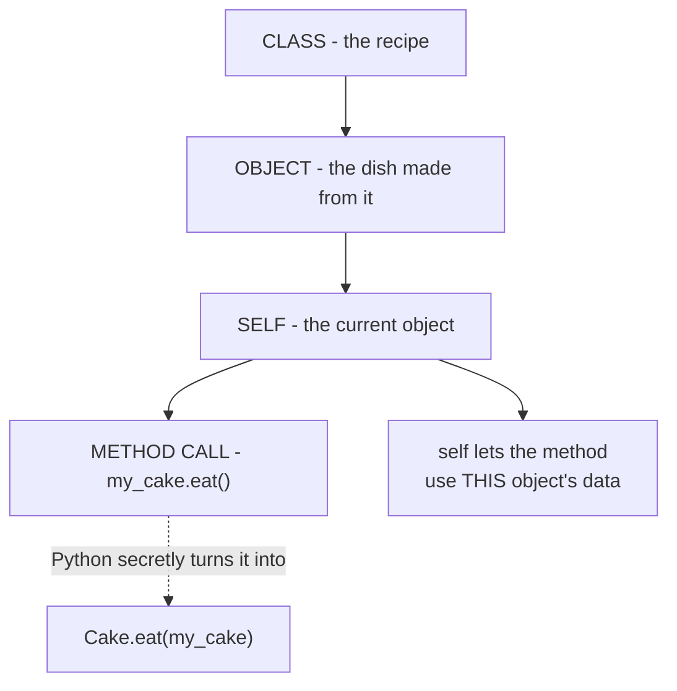

# OOP & `self` — Made Super Simple

**📊 Diagram — Topic overview: class → object → self at a glance**



## Think of it like this

A **Class** is a **recipe**.
An **Object** is the **dish you actually make** from that recipe.

```python
class Cake:              # the recipe
    def __init__(self, flavor):
        self.flavor = flavor
    def eat(self):
        print(f"Eating a {self.flavor} cake")
```

```python
my_cake = Cake("chocolate")   # now we baked a real cake (an object)
my_cake.eat()                 # ✅ only a real cake can be eaten
```

## The Golden Rule

> Only an **object** can use the things inside its class.

Inside the class you only have the recipe (blueprint) — no real object yet.
So when a method wants to use the class data, it needs **the object** to talk to it.

## What is `self`?

> `self` is just a name for **"the current object"**.

When you call a method on an object, Python secretly sends that object
into the method as the first argument — and we call it `self`.

```python
my_cake.eat()
# Python secretly does this:
Cake.eat(my_cake)
# so inside eat(), self = my_cake
```

## One simple example

```python
class Dog:
    def __init__(self, name):
        self.name = name          # self = the dog being created

    def bark(self):               # self = the dog that barks
        print(self.name + " says woof!")
```

```python
d1 = Dog("Tommy")     # Python calls Dog.__init__(d1, "Tommy")
d2 = Dog("Lucy")      # Python calls Dog.__init__(d2, "Lucy")

d1.bark()             # Tommy says woof!   → self = d1
d2.bark()             # Lucy says woof!    → self = d2
```

The method `bark` is the same for both, but it prints different names — because `self` is whichever dog called it.

## What happens WITHOUT self?

```python
def bark(self):
    print(self.name + " says woof!")   # ✅ works
```

```python
def bark():
    print(name + " says woof!")        # ❌ error — which dog's name??
```

Without `self`, the method has no idea **which object** it belongs to.
It's like a dog trying to bark without knowing who it is.

## Remember these 3 things

1. `self` = the current object.
2. Python passes it automatically — you don't write it.
3. It must be the **first** thing inside every method's brackets.

## Summary in one line

> `self` is the current object, passed automatically to a method, so the method can use that object's data.